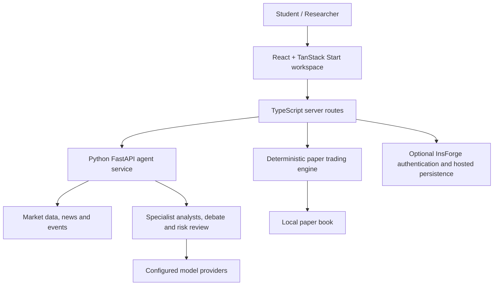

<div align="center">

# QUANT PLUS

### See the market differently.

**An agentic research and paper trading platform for Indian equities.**

Observe the market. Investigate the evidence. Challenge the thesis. Practise the decision.


[Explore the source](sem%207/Working%20Model%20Source%20Code/) · [Read the research paper](sem%207/Research%20Paper.pdf) · [Open the project report](sem%207/Final%20Project%20Report%20%28Black%20Book%29.pdf)

</div>


## The idea

Stock research often means switching between charts, news feeds, analyst opinions and portfolio spreadsheets. The reasoning behind a decision can get lost along the way.

Quant Plus connects those steps in one workspace. Users can explore NSE stocks, inspect a committee of AI research agents, examine opposing arguments, understand risk, place a simulated trade and review the outcome. Evidence, reasoning and practice stay connected throughout the process.

```text
Observe → Investigate → Challenge → Understand risk → Practise → Record → Evaluate
```

## What you can explore

| Module | What it brings to the workflow |
| --- | --- |
| **Market workspace** | Provider-backed quotes, historical charts, stock discovery, watchlists and screeners. |
| **AI research committee** | Specialist technical, fundamental, news, macro and event perspectives, followed by debate, challenge and risk review. |
| **Quant AI copilot** | Context-aware explanations using available market, research and portfolio evidence. |
| **Ripple Engine** | Connected-stock relationships and possible second-order market effects. |
| **News and sentiment** | Company events, news context and market sentiment with source and availability information. |
| **Paper trading** | Virtual cash and holdings, order validation, reservations, partial fills, charges, protective exits and settlement-aware accounting. |
| **Portfolio and risk** | Exposure, concentration, decision plans and trade review tools. |
| **Learning and reflection** | Journaling, replay, research history, strategy exploration and learning tools. |

AI outputs contribute research and explanations. Deterministic application code validates and applies changes to the paper account. Trading uses virtual funds; research outputs do not establish a forecasting or investment-performance guarantee.

## A look inside

<table>
  <tr>
    <td width="50%"><strong>Stock research and trading workspace</strong></td>
    <td width="50%"><strong>AI debate and research committee</strong></td>
  </tr>
  <tr>
    <td></td>
    <td></td>
  </tr>
</table>

Screenshots are included in the submitted source. Live data and AI features depend on configured providers and their availability.

## How it fits together



| Layer | Technologies |
| --- | --- |
| Interface | React 19, TypeScript, TanStack Start and Router |
| Styling and charts | Tailwind CSS 4, Radix UI, Lightweight Charts, Recharts |
| Web runtime | Node.js, Vite, Nitro |
| Agent service | Python 3.11, FastAPI |
| Research | Specialist agent orchestration, structured evidence and configurable model gateways |
| Persistence | Local paper book; InsForge authentication and hosted persistence when configured |
| Verification | Node test runner, pytest, Playwright, TypeScript and ESLint |

## Academic submission

This repository contains the semester documents and the working model source for **Capstone Project 12 · Academic Year 2026–27**.

```text
Cp_12_2026-27/
├── README.md
├── sem 6/
│   ├── Project Synopsis.pdf
│   ├── Project Logbook.pdf
│   └── Project Reports.pdf
└── sem 7/
    ├── Final Project Report (Black Book).pdf
    ├── Research Paper.pdf
    ├── Project Logbook.pdf
    └── Working Model Source Code/
        ├── README.md
        ├── web/
        └── agent/
```

| Semester | Deliverable | Open |
| --- | --- | --- |
| 6 | Project Synopsis | [PDF](sem%206/Project%20Synopsis.pdf) |
| 6 | Project Logbook | [PDF](sem%206/Project%20Logbook.pdf) |
| 6 | Project Reports | [PDF](sem%206/Project%20Reports.pdf) |
| 7 | Final Project Report — Black Book | [PDF](sem%207/Final%20Project%20Report%20%28Black%20Book%29.pdf) |
| 7 | Research Paper | [PDF](sem%207/Research%20Paper.pdf) |
| 7 | Project Logbook | [PDF](sem%207/Project%20Logbook.pdf) |
| 7 | Working Model Source Code | [Source and setup](sem%207/Working%20Model%20Source%20Code/) |
| 7 | Project Demonstration Video — 3 minutes | To be added |

## Run the working model

**Requirements:** Node.js 22.14 or newer, npm, Python 3.11 and Git. The Python dependency lock was validated on Windows with Python 3.11.9.

Clone the submission and open its source folder:

```powershell
git clone https://github.com/itprojects-create/Cp_12_2026-27.git
Set-Location "Cp_12_2026-27/sem 7/Working Model Source Code"
```

Install the frontend:

```powershell
Set-Location web
npm ci
if (-not (Test-Path .env.local)) { Copy-Item .env.example .env.local }
Set-Location ..
```

Install the backend:

```powershell
Set-Location agent
py -3.11 -m venv .venv
.\.venv\Scripts\python.exe -m pip install -r requirements.lock.txt
if (-not (Test-Path .env)) { Copy-Item .env.example .env }
Set-Location ..
```

Configure `web/.env.local` and `agent/.env` using the supplied examples. Set backend `WEBSITE_API_KEY` and frontend `AGENT_SERVICE_API_KEY` to the same private value, and set frontend `AGENT_SERVICE_URL=http://127.0.0.1:8000`. AI features require model-provider credentials; broker market data requires Fyers configuration and login. Leave hosted account flags unset for a fresh local paper book, or follow the InsForge migration guide for hosted setup.

In one terminal, from the source folder, start the backend:

```powershell
Set-Location agent
.\.venv\Scripts\python.exe -m uvicorn app.main:app --host 127.0.0.1 --port 8000
```

In another terminal, from the source folder, start the frontend:

```powershell
Set-Location web
npm run dev
```

Open the local URL printed by Vite. For the full configuration guide and the optional Windows launcher, see [Working Model Setup](sem%207/Working%20Model%20Source%20Code/README.md).

## Engineering and verification

The project includes checks for paper-account integrity, market data handling, agent integration, user flows and recovery. Run these frontend checks from `web/`:

```powershell
npm run typecheck
npm test
npm run build
```

Additional backend and browser checks are described in the [source setup guide](sem%207/Working%20Model%20Source%20Code/README.md) and declared in [package.json](sem%207/Working%20Model%20Source%20Code/web/package.json).

The frontend production build passed during submission preparation. The six semester PDFs were verified against the originals, and the submission was checked for configured credentials. This preparation did not rerun the full backend and browser test suites.

## Explore further

| Resource | What to read |
| --- | --- |
| [Product overview](sem%207/Working%20Model%20Source%20Code/web/QUANT_PLUS_OVERVIEW.md) | Product modules, research workflow and user journeys. |
| [Technical presentation](sem%207/Working%20Model%20Source%20Code/web/PROJECT_PRESENTATION.md) | Architecture, design decisions, evaluation and research limitations. |
| [Agent integration](sem%207/Working%20Model%20Source%20Code/web/AGENT_INTEGRATION.md) | How the web application connects to the Python service. |
| [InsForge migration](sem%207/Working%20Model%20Source%20Code/web/INSFORGE_MIGRATION.md) | Hosted authentication, persistence and migration details. |

The linked technical documents preserve their original dates and development context. Use this README and the working model setup guide for the college repository's folder layout and startup commands.

---

<div align="center">

**Market evidence → Explainable research → Disciplined paper practice**

Quant Plus · Capstone Project · 2026–27

</div>
