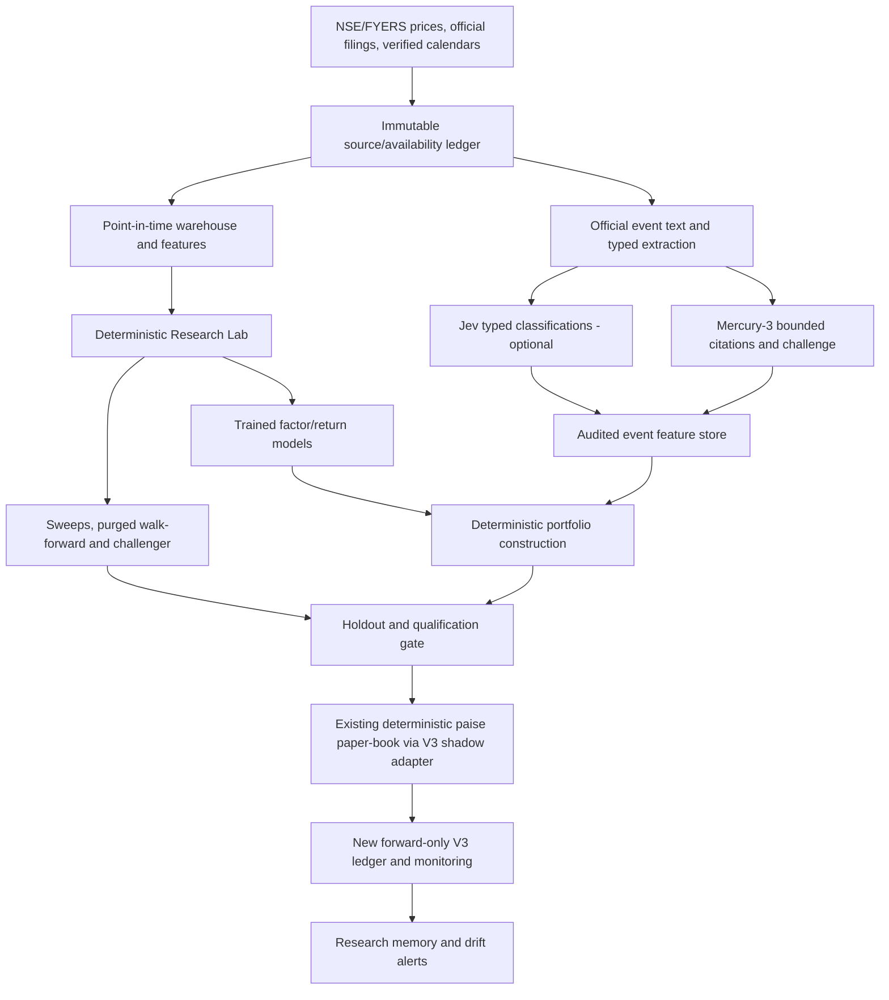

# QUANT PLUS V3.1 — UNIFIED RECOVERY AND RESEARCH BLUEPRINT
## NSE quantitative research operating system + Jev evidence intelligence + Mercury-3 research + honest paper execution

**Edition:** final consolidated implementation specification, 12 November 2026  
**Audience:** engineering owner, coding agent, reviewers, research operators  
**Replaces as the execution plan:** the earlier V3 recovery blueprint and V3 Jev master prompt. Those remain historical references, **not** additional queues of work.  
**Source material:** `Status.md` (snapshot 11 Nov; last operational readings 6–7 Nov); `Agentic AI for Hedge funds.docx` (14-page QuantGPT/MCP/hedge-fund-style operator roadmap); preceding V3/Jev recovery documents; official Jev, FYERS, NSE and SEBI documentation linked in §22.  
**Evidence boundary:** This is an *architecture and implementation specification*. We did not access the user's `D:\Quant-Plus` or `D:\QP\agent-service`, inspect the current SQLite database, obtain historical exchange data, call a credentialed Jev endpoint or train a model. All alleged implementation defects must be reproduced or ruled out on the actual checkout. The source documents make **no verified profitability claim**. This document makes none either.

---

## 0. Executive decision: ONE plan, not two projects

**Build Quant Plus V3.1 directly.** Do **not** separately execute all the old V3 steps and then bolt on the hedge-fund document. The new dependency order is:

**W0** safeguard V2 + audit settlement/abstention/economics/operations → **W1** point-in-time NSE warehouse + execution-cost truth → **W2** executable automated Research Lab + falsification → **W3** independent quantitative models and portfolio selection → **W4** optional Jev event intelligence + Mercury-3 research tools and paired ablations → **W5** strategy library + historical-event replay + living research journal → **W6** forward-only V3 paper trading, monitoring, promotion/rejection decision.

A previous capability already works? **Reuse and extend it.** A prior safety control already exists? **Keep it enforced.** A dependency is missing? **Report `BLOCKED` with evidence, not fabricated coverage.** A candidate loses after costs? **Reject the candidate**, not the accounting.

**Major change from V3:** the research laboratory (valid data, costs, actual repeatable backtests, sweeps, holdout, challengers) must exist *before* model training is evaluated. **Jev is only a candidate feature/evidence classifier, never a substitute for a learned trading edge.** All execution is paper-only.

### 0.1 The product after V3.1

> An inspectable Indian-equity research terminal in which an agent can propose a hypothesis, deterministic tools can test and disprove it, numerical models may rank opportunities, Jev may classify official evidence, and only the deterministic paper engine can simulate an order. Every claim can be traced from the point-in-time source through costs to actual forward outcomes.

### 0.2 Success criteria that do not cheat

**Engineering success:** reproducible, verified workflows that correctly reject bad hypotheses, reconcile cash, preserve data provenance, maintain ongoing data capture and disclose uncertainty.  
**Scientific success:** a candidate consistently beats preregistered controls on untouched data with adequate time-clustered uncertainty and robustness.  
**Economic success:** a realistic, executable portfolio shows positive *absolute net* return after fees and slippage, and an attractive net risk-adjusted outcome versus relevant alternatives over enough independent market time.  
**Not promised:** any fixed accuracy, win rate, Sharpe, profit, date to profitability or live brokerage authorization.

---

## 1. Immutable starting point: what `Status.md` actually establishes

| Evidence in the user's status document | Consequence for V3.1 |
|---|---|
| 11 historical single-stock agent evaluations; **0/11 beat the best constant baseline**, with 5.88%–50.00% accuracy on small decisive sets | Language-model committee votes have not demonstrated directional skill. Preserve these results; don't combine repeated scenario sets as independent samples. |
| Approx. **317–320 cards** at the 6–7 Nov recorded read; **2 settled**, **1 scored** | No statistically meaningful v2 forward-performance assessment yet. Do not report a profitable system. |
| Recent 100-card sample: **12/100 answerable at 5D**, **11/100 at 20D** | Diagnose exactly which evidence and aggregation gates exclude a card. Numeric price-only coverage should not depend on a headline. |
| `bridge.py` uses `mean(realised excess of bullish) − 0.004` | Benchmark-relative outperformance is not actual investor profit; flat costs ignore order size. |
| `shadow.py` computes `realised excess − 0.004` without independent executable fills | Existing results are research evidence, not actual order-driven paper P&L. Keep them immutable and distinct from V3.1. |
| October/November scheduler losses caused by sleep/shutdown; one PowerShell split bug already fixed | A durable worker and missed-run alerts are necessary; do not backdate missed forward cards. |
| Existing FastAPI research service, React terminal, 12-role graph, forecast-v2, Ripple Engine, Strategy Lab, research journals, deterministic paise book, InsForge option | Extend existing modules and interfaces, not rebuild the platform or disable V2. |
| Paper only, FYERS observations, NSE cash equity delivery and `RESEARCH_ONLY` agent authority | Live broker execution stays out of scope; existing deterministic risk and auth checks remain. |

**P0 maturity check:** for a card locked after the **30 October 2026** completed NSE session, a conventional *five subsequent trading-session* horizon is expected to reach **6 November 2026**, provided the exchange calendar and card semantics support this. A 6–7 Nov recorded ledger with only two settlements is suspicious, **not proof of a defect**. Inspect the particular card's `as_of`, `matures_on`, input close, the five trading dates, missing market prices, job receipts, and snapshot timestamp before patching logic. The older two settled outcomes might refer to older cards.

**Do not change old forecast hashes or outcome tables to make the score look better.** A known contaminated 100% archived report is `DO_NOT_USE`; preserve that quarantine.

---

## 2. What the hedge-fund-style guide contributes, precisely

The supplied *Build Your Own AI Trading Desk*, by Aryaman Upmanyu, describes QuantGPT's US-focused research workflow and MCP tool interface. **Its claims are the guide author's descriptions, not independently verified performance of Quant Plus.** It is relevant for workflow design, not as a purchasable replacement for NSE data.

| Guide section | Adopt into Quant Plus | Existing building block / important limitation |
|---|---|---|
| Pages 2–3: data, compute, trading infrastructure; survivorship and look-ahead | Reproducible PIT warehouse, supervised jobs, data quality gates | Current FYERS history and forecast ledger are not a historical constituent warehouse. |
| Pages 6–8: question → backtest → verdict → sweep | `run_backtest`, `run_sweep`, verdict and run archive | Strategy Lab has checks; audit whether they are runnable on real PIT Indian data. |
| Pages 8–9: historical strategy library | Start from published momentum, quality, post-earnings drift hypotheses | Do not transplant US profitability to India. |
| Pages 9–10: historical-event “futuretest” | Historical event replay for current/simulated portfolios | Rename *Historical Crisis Replay*; it is a conditional historical stress estimate, **not a forecast**. |
| Page 10: continuously recheck research journal | Living experiment registry + decay/drift alerts | Extend existing Research Network and Track Record. |
| Pages 10–11: paper first + server runner | Independent continuous worker + realistic paper execution | Guide's Alpaca runner is US-only, not a shortcut to NSE live orders. |
| Page 11: command center and honest labels | Visible `BACKTEST`, `RETROSPECTIVE`, `FORWARD_SHADOW`, `UNAVAILABLE` tags | The UI must not present hypothetical returns as actual cash profits. |

**QuantGPT's official MCP page** describes `run_backtest`, `run_sweep`, `challenge_finding`, research search and read-only warehouse queries, and explicitly says US stocks only for its equity backtests (as of its 27 Oct 2026 update). Use those *patterns* to build controlled native tools on Quant Plus; a QuantGPT account, subscription or API connection is **not** required for V3.1.

---

## 3. Architecture and custody: add a research plane without weakening the money plane



### 3.1 Preserve these boundaries

1. **Observation plane:** timestamps, data provenance, raw content hashes, quote eligibility and authoritative financial numbers. Provider or deterministic validators own these.
2. **Research plane:** models and tools can read, propose, challenge, classify, compare and abstain. No model has mutation rights to balances, risk limits or broker API endpoints.
3. **Execution plane:** the established server-owned paise book owns order intents, reservations, fill simulation, itemized charges, T+1 settlement and ledger reconciliation. Client/model prices are ignored for fills.
4. **Audit plane:** V2 immutable hash-linked records remain untouched; V3.1 uses a separately named ledger, versioned experiment registry and distinct shadow account/run identity.

### 3.2 Existing code map to inspect, not assume

- Main repository: `D:\Quant-Plus` (React 19, TanStack Start, backend extension, source code and front-end).
- Research service: `D:\QP\agent-service` (FastAPI agent service installed separately).
- Forecast extension: `backend-extension/quantplus_intelligence/forecast/` with `evidence.py`, `forecasters.py`, `aggregate.py`, `risk.py`, `scoring.py`, `ledger.py`, `bridge.py`, `shadow.py`, `jobs.py`.
- Current execution: application/server-side paper-book engine with local JSON v2 or InsForge PostgreSQL; inspect service boundaries before reusing it.
- Existing strategy/research: Strategy Lab, Replay, Ripple Engine, Research Network, Track Record, journal, risk centre.
- All paths, versions and contracts must be verified in the actual checkout. Proposed new modules below are **suggestions**, not claims of files that already exist.

---

## 4. Wave 0 deep diagnosis: evidence BEFORE reconstruction

### 4.1 Safeguard baseline

Create a clean working branch without modifying published Lovable history. Save `git status`, commit/hash, environment capabilities, installed dependency versions, dataset manifests, current feature flags and test results. Back up databases safely (SQLite online backup API / consistent snapshot, not copying an active WAL file alone). Hash (SHA-256) *bytes* of historical `forecast` ledger backups, pre-existing V2 shadow JSONL, reports and original schema migration files. Record chain verification before changing anything. No mutation to historical V2 rows, chain heads, `recorded_at` or `settled_at`.

### 4.2 Four independent root-cause inquiries

**A. Forecast settlement completeness**

- Inventory all cards by `as_of`, horizon, `matures_on`, `recorded_at`, source completeness and settled/scored flag.
- For **30 Oct 5D** cards, enumerate the verified five subsequent sessions and last *eligible* price; inspect 6 Nov job timestamp and ledger readback time.
- Build a reconciliation diagnostic that classifies every candidate as `NOT_MATURE`, `MATURE_WAITING_FOR_PRICE`, `MATURE_WAITING_FOR_JOB`, `ALREADY_SETTLED`, `INVALID_CALENDAR`, `SOURCE_MISMATCH` or `RECORDED_AFTER_MATURITY`.
- Check job leases, retries, data provider gaps, SQL WAL reader paths and timezone conversions (UTC vs `Asia/Kolkata`).
- Only settle if the original code's knowability rules and price validity prove eligibility. Failed historical captures are not repaired by backdating a new forward forecast.

**B. Abstention waterfall, same-batch**

For every `(symbol, horizon, as_of, model/rubric_version)`, record number of eligible input bars, data delays, missing news/events/flows, per-forecaster vote/abstention reasons, aggregation active-vote count, final veto/tripwire and whether the card was locked. Compute cohort-specific counts. The record that 6 of 8 forecasters voted on one batch **does not contradict** 12 of 100 cards answerable on another batch without reconciling dates and versions. Fix accidental coupling: price-only model can forecast when optional event/news is absent; an event-specific hypothesis must abstain when required event evidence is absent.

**C. Economic correctness**

Trace exact definitions of `realised excess`, target labels, `long_edge`, `net`, zero-drift bands and half-Kelly-like sizing. Create regression fixture:

```
stock return = -5.0%; benchmark return = -6.0%
gross relative outperformance = +1.0 percentage point
absolute trade return after any positive cost = worse than -5.0%
```

The bridge must never expose a positive relative spread as positive investor cash P&L. V2 series must stay unchanged; create a distinct correct V3 series rather than altering the old paper experiment.

**D. Operations and determinism**

Reproduce idempotent catchup, machine-off missed run, partial batch interruption, retry, fixture isolation, FYERS quota exhaustion, Yahoo missing rows, secrets and clock drift. Define worker heartbeats and named alert conditions. Verify existing workers and task names before proposing replacements.

### 4.3 W0 exit gate

- One test/trace or SQL readback establishing truth for each suspected issue; hypotheses explicitly marked `NOT_REPRODUCED` or `INSUFFICIENT_EVIDENCE` when appropriate.
- Historic V2 hashes and counts unchanged.
- Corrected status dashboard and diagnostic outputs; no trade outcome invented.
- A minimal safe patch where a bug is *actually* reproduced, covered by regression tests.

---

## 5. Wave 1: reliable point-in-time Indian market warehouse

The **main bottleneck may be data quality and missing historical breadth**, not compute power. Historical trade simulation with current NIFTY members, today's event knowledge, adjusted prices or survivorship-biased data is worse than no backtest.

### 5.1 Minimal typed entities

| Entity | Required fields and rules |
|---|---|
| `instrument_master` | stable ISIN / symbol aliases, listing/delisting and trading status, series, exchange, identifier provenance, effective interval |
| `universe_membership` | index/sector membership start/end dates **as then known**, additions, deletions; immutable source snapshot and retrieval time |
| `daily_bar` | session, official OHLCV, source, `published_at`, `first_seen_at`, `available_at`, checksum, completeness, adjustment basis, quality status |
| `corporate_action` | action type, announcement/record/ex/payable dates, adjustments, dividends, source and timestamps; distinguish adjusted total-return research from actual cash ledger events |
| `benchmark_bar` | price index and when available total-return index (separate), constituent regime, session alignment, source |
| `issuer_event` | exact issuer/ISIN, filing ID and URI, raw document hash, exchange published time, retrieval time, first-known time, source text, parser version, review state |
| `feature_snapshot` | symbol, horizon, **decision cutoff**, feature code+data versions, missingness, source hashes, as-of joins, frequency |
| `target_label` | decision time, next *tradable* fill reference, exit horizon, return type (absolute/relative), corporate action treatment, `matures_at`, quality and actual knowability |
| `fee_schedule` | broker/instrument/side, charge component and effective date, min/max, rounding and per-execution versus per-ISIN/day scope |

**Five clocks:** underlying economic period, published time, first seen, available to the strategy, and order/decision time. Enforce `available_at <= decision_cutoff` across every join; data not archived contemporaneously is marked `RETROSPECTIVE` if used in simulated historical feature production. A modern reconstruction is not a locked historical prediction.

### 5.2 Data acquisition guardrails

- Verify lawful access, rights, commercial reuse, historical depth and official file retention before building automatic downloaders. NSE publishes capital-market historical reports, security-wise OHLC/volume and reports; coverage and member-history completeness must be audited by actual downloaded files, not assumed.
- Prefer primary NSE reports and appropriately licensed data sources over arbitrary Yahoo/yfinance reconstruction; Yahoo may be used only as a labelled fallback when admissible.
- Do **not** fill a missing close, missing historical issuer, delisted stock or unsourced index constituent with a fabricated value.
- Track adjusted and unadjusted series separately. Backtests must model dividends, splits, bonuses, rights, mergers, suspended trading, delistings and tender/exits according to source evidence. If unavailable, reduce research scope and disclose.
- Enforce session calendar and a stable instrument-to-ISIN mapping; treat special sessions, holidays, trading halts and corporate actions carefully. No in-session daily-bar leakage.
- Daily ingest is append-only with unique source record IDs, checksums, coverage/staleness reports, source mismatch quarantine and reproducible Parquet/SQLite metadata, using existing storage conventions where possible.
- On any dataset with insufficient point-in-time membership, explicitly label backtest `SURVIVOR_BIASED_RESEARCH_ONLY` and forbid strategy promotion.

### 5.3 Data acceptance

Must show (a) complete provenance for every input to at least one tiny study, (b) forbidden future-data joins fail, (c) missing/delisted handling is deterministic, (d) corporate action and calendar fixtures are correct, (e) independent source comparison samples, (f) explicit historical universe coverage report. A large download that cannot pass these gates does not count.

---

## 6. Wave 1: trade economics and executable labels

### 6.1 Model real all-in economics, not a universal 0.4% shortcut

At time of plan writing, FYERS documents NSE cash-equity **delivery brokerage = min(0.3% × each executed order's value, ₹20)**. Other fee items and applicable rates are broker-, date-, segment- and trade-specific. Use the **existing date-versioned integer-paise** execution fee engine as the single source of truth after audit, including STT, exchange fees, SEBI fees, stamp duty, GST, applicable DP debit, rounding, partial fills, liquidity, spread and slippage. Fund/strategy data costs are separately accounted as research operating expenses; do not hide them inside realized returns.

Correct exact-balance semantics:

```
reference forecast return       = P_target / P_reference - 1, properly adjusted
benchmark excess forecast       = stock_return - aligned_benchmark_return
executed absolute trade P&L     = sale_proceeds - purchase_cost - all attributed charges
net strategy NAV return         = (NAV_t - NAV_t-1 - external_cash_flows) / comparable_base
net benchmark-relative return   = strategy_net_return - aligned_benchmark_total_return
```

Execution may use quoted ask/bid, time-stamped next-session observed prices or conservative proxies; each mode must be clearly labelled. Never fill at a decision cutoff's already known close for a strategy that only decided after that close. No guarantee that stop orders fill at stop prices through gaps.

### 6.2 Price/volume labels to train against

- Target `h=20` (initial) and optionally `h=60` for slower trends. `h=5` is exploratory and should not drive frequent delivery trades without demonstrating cost feasibility.
- Model `gross_absolute_return_h` and related uncertainty, optionally benchmark-relative alpha, **but qualification uses simulated net actual fills**.
- Add `next_eligible_entry_time`, `next_eligible_exit_time`, `entry_execution_policy`, `exit_execution_policy`, fee schedule version and data availability flags.
- Model payoff magnitude and negative tail probability, not just `P(up)`. Do not size via binary `p` alone. Use conservative volatility/risk/correlation constraints and full cash availability.
- Broker costs for 10k and 100k notionals should differ; actual regression fixtures must reconcile cent-for-cent/paise-for-paise with order ledger.

### 6.3 W1 exit gate

At least one usable PIT research panel with documented limitations; executable fee-correct buy/hold/sell simulation; exact reconciliation with deterministic book fixtures; matching calendar and cutoff; no borrowed cash, unsupported shorting or future data. Do not claim full NIFTY 500 research if data only covers NIFTY 100.

---

## 7. Wave 2: the Automated Quant Research Lab (THE biggest new feature)

Build a usable, headless experimental workflow **before** shipping a shiny new dashboard. Use existing Strategy Lab/Research Network semantics wherever possible.

### 7.1 Canonical experiment contract

```yaml
experiment_id: immutable id
hypothesis: natural-language question converted to a typed rule and reviewed
strategy_spec_version: pinned
candidate_family: sector_momentum | near_52w_high | earnings_drift | quality | other
universe_spec: PIT membership rule and version
feature_set_version: pinned
start_session: ISO date
end_session: ISO date
signal_cutoff_rule: completed_bar_only
entry_policy: next_eligible_session | next_verified_observation
exit_policy: horizon | time | risk_rule
capital_inr: explicit
rebalance_calendar: deterministic
portfolio_constraints: max_name | max_sector | liquidity | cash | exposure
fees: exact versioned paper fee model
slippage_scenarios: base | double | adverse
training_window: chronological
validation_windows: purged rolling/expanding
sealed_holdout: fixed once BEFORE running candidate search
random_seeds: fixed
pre_registration_timestamp: immutable
source_hashes: complete
result_state: DATA_BLOCKED | RESEARCH | REJECTED | TRADE_OFF | OOS_VALIDATED | SHADOW_CANDIDATE
```

`OOS_VALIDATED` is *not* the label `PROFITABLE` or `READY_TO_LIVE_TRADE`.

### 7.2 Research engine tools (capability-limited)

The **internal** tool registry can be exposed to the agent service as explicitly allowlisted tools and optionally via an MCP-compatible adapter. The names below are proposed names, not current Quant Plus endpoints:

| Proposed tool | Inputs | Typed output / restriction |
|---|---|---|
| `list_data_coverage` | universe, dates, fields | PIT coverage, source, excluded names; read only |
| `describe_strategy` | strategy ID / version | static DSL, parameters, citations and data requirements |
| `run_backtest` | pre-registered StrategySpec | immutable run ID, net NAV, cash-flow ledger, benchmark, costs, data warnings |
| `run_sweep` | base spec + **bounded** parameter grid | candidate comparisons, surface/heatmap, multiplicity metadata, same holdout policy |
| `challenge_finding` | immutable run ID | battery of adversarial tests and verdict; cannot edit result |
| `compare_runs` | explicit immutable run IDs | paired differences and independent-time uncertainty |
| `run_historical_replay` | portfolio snapshot + vetted event bundle | crisis stress paths and comparability limitations |
| `research_journal_status` | strategy/version | last check, drift, state, citations and next validation due |

Security: read-only research datasource accounts; no unrestricted model-authored SQL, shell, Python or arbitrary file paths; validate StrategySpec against an allowlisted DSL; bounded CPU, RAM, time, provider requests, concurrent jobs, spend ceiling and rate limits; content addresses for caching; manual approval for budget increases. **Tools cannot access paper mutations, broker order endpoints or user secrets.**

### 7.3 Study verdicts: more than a green Sharpe

- `DATA_BLOCKED`: source, PIT, historical membership, adjusted-price or fee integrity insufficient.
- `NO_EDGE`: candidate fails preregistered baseline/robustness criteria or is indistinguishable under stated uncertainty.
- `TRADE_OFF`: improves some dimensions but worsens others; explain explicitly and do not treat as automatic approval.
- `OOS_VALIDATED`: passed predeclared historical time-split criteria and data gates; **historical only**.
- `SHADOW_CANDIDATE`: separately approved for forward-only paper testing.
- `DEGRADED`: previously qualified but new live monitoring indicates drift, unacceptable cost/coverage or risk.

An external guide's `DATA VALIDATED` label based on CAGR/Sharpe is a useful pedagogical starting point, not a sufficient financial acceptance standard. We additionally require executable net cost, benchmark consistency, independence, capacity and multiplicity checks.

### 7.4 Sweeps with actual robustness, not selection bias

For initial strategies, sweep narrow, declared neighbourhoods such as momentum lookback `{63,126,189,252}` sessions, volatility window `{20,40,60}`, signal threshold bands, and rebalancing frequencies `{monthly, 6-weekly, quarterly}` where data supports. Keep cardinality bounded; no unlimited search until performance improves. Plot performance surface with a **parameter stability region**, not simply the best cell. Track number of hypotheses/parameters tried. A single lucky peak is a rejection signal. All candidates share comparable test periods/capital/cost cases.

A sealed final holdout must never be used to tune a rejected strategy. After revealing the holdout, it cannot be recycled as untouched evidence. Future observations can supply a new truly forward test; using them takes real time.

### 7.5 `challenge_finding`: adversarial checks, deterministic and reproducible

1. Time-travel/availability test including news publication vs retrieval and corporate action dates.
2. Historical universe survivorship and delisting coverage test.
3. Train/validation label overlap with a purge and embargo matching the maximum label horizon.
4. Walk-forward stability and chronological regime tests; show every fold.
5. Costs at actual position sizes, 2× fees/slippage and low-liquidity impact scenario.
6. Parameter neighbourhood plateaus and turnover/rebalance-day sensitivity.
7. No one stock, sector, month or event dominating total return.
8. Baseline comparisons: cash, aligned NIFTY index total return, equal-weight, simple momentum/sector trend and market/sector exposures.
9. Placebo labels, shuffled/separated returns (only appropriate time-block methods) and random matched portfolios.
10. Multiple-testing and researcher degrees-of-freedom report; selection-adjusted significance where feasible.
11. Stop/exit realistic gaps, partial fills and one-sided limit/illiquidity behaviour.
12. Model/API out-of-service and missing-data fallback behaviour.
13. Point-in-time instrument identifiers and corporate-action event correctness.
14. Independent implementation/cross-check of a small sample of ledger NAV and fee transactions.
15. Uncertainty from date-block bootstrap or similarly defensible dependence-aware technique; never treat 200 names on one day as 200 independent market days.

Each check records `PASS / FAIL / INCONCLUSIVE`, exact reason, run hash, sample, source and reproducible commands. **Any failed integrity check blocks promotion.** Optional model-quality challenges can fail and reject strategy without blocking other experiments.

### 7.6 W2 exit gate

At least two full, reproducible, cost-inclusive experiments with deterministic output and independent checks; at least one wide parameter sweep, challenger proof that intentionally leaking future data gets blocked, a noise/no-edge study rejected, and an explicit `DATA_BLOCKED` example. A proof UI is optional until the headless results are correct.

---

## 8. Research hypotheses: what to test first, without claiming an edge

### H1. Sector-relative medium-horizon momentum — first control

- Universe: sufficiently liquid Indian listed equities with **historically verified** membership and eligibility, e.g. actual-date NIFTY 100/200 if obtainable.
- Signal: 6/12-month price momentum; optional skip-most-recent month; trend consistency; historical relative performance versus valid sector peer group; realized volatility and liquidity controls.
- Portfolio: long-only, sector/name exposure caps, rebalance monthly or slower when feasible; holding period 20–60 sessions with turnover buffer/hysteresis.
- Hypothesis: persistent relative price strength may overcome retail delivery costs more plausibly than daily high-turnover classification.
- Baseline: risk-matched simple momentum, equal-weight and eligible NIFTY strategy/price+TR benchmarks, with methodological differences disclosed.

### H2. 52-week-high proximity / trend continuation

Test percentile distance to historically knowable 52-week highs with volatility and volume filters. Test long horizon with broad parameter plateau. Do not compute a “52-week” high from only 65 historical bars, a defect documented in original AI audits.

### H3. Post-earnings announcement drift (event-specific, gated)

Require timestamped earnings disclosure, comparable prior-period metrics, real announcement/available time, financial numerics extracted by deterministic verified source parsing, and sector/market context. Jev may classify **whether a qualifying event is present and material**, never generate the surprise magnitude or infer a stock-return probability. Model the next eligible execution after disclosure, not a trade at an earlier close. If event timestamp/adjusted data is insufficient, label `DATA_BLOCKED`, not backfill from today's web.

### H4. Quality/value overlay (later)

Use only timestamped, standardized historical filings with filing-date rather than fiscal-quarter-date availability. Include restatements and lags. Stop if PIT fundamentals unavailable. A US “Magic Formula” example from the guide is a **research hypothesis**, not evidence of Indian outperformance.

### Deliberately deprioritized

HFT, microsecond scalping, self-directed unconstrained RL trading, shorting cash-equity delivery, options/futures and frequent 5D large-turnover bets. None is justified by current data/exchange connectivity/authority.

---

## 9. Wave 3: trained quantitative alpha and portfolio models

**Never train the language model to guess prices from the guide or from marketing narratives.** Build numerical baselines with interpretable statistics and calibrated distributions.

### 9.1 Model ladder, simplest first

1. Trivial controls: cash, sector/market neutral null, constant base rate, equal-weight, static sector-relative momentum and reversal.
2. Elastic net or ridge/logistic model trained on time-safe features to forecast conditional excess/absolute returns and event outcome probabilities where appropriate.
3. Gradient-boosted trees (XGBoost/LightGBM/CatBoost if already available/licensed) with constraints, fixed seeds, documented tuning budget and no leak.
4. Optional modest ensemble **only after** each component improves independent out-of-sample metrics.
5. Explicit horizon-specific models with feature/missingness lineage and model version (20D first; 60D when sufficient; 5D research only).

No deep model or RL is required to ship V3.1; positive net return and independent validation, not model complexity, select the approach.

### 9.2 Train/validate rigorously

- Train on multiple chronological folds; use **purge/embargo** where outcome windows overlap, fit preprocessing only on training folds, and prevent current constituent lookups in historical panels.
- Search hyperparameters in train/validation only; choose rules before sealed holdout. Capture tried alternatives in experiment registry.
- Split by market time, not randomly by rows. Evaluate with per-date and per-sector grouping; report effective number of time blocks.
- Training labels use next executable fills and known corporate actions. Report 20D/60D separately; don't leak next-close returns to cutoff features.
- Evaluate rank IC by day and across independent dates, hit-rate calibration vs base rate, Brier/log loss (probability models), pinball/CRPS/interval coverage (distributional models), and **net portfolio NAV**.
- Robustness must include model error bars, missing-feature cases, turn-over changes, outlier periods and market/sector neutrality.

### 9.3 Deterministic portfolio/risk compiler

Use forecast expected-return distribution **and** execution cost, liquidity, concentration, risk budget, worst-case loss and turnover constraints. Avoid a Kelly fraction computed from `p > 0.5` alone. Define no-trade when expected net opportunity is inadequate after uncertainty buffer or when portfolio risk caps would be violated. A model predicting positive average return does not authorize a paper order unless deterministic code selects it.

### 9.4 W3 exit gate

Paired evaluations with a frozen simple baseline under identical costs, dates, eligible names, capital and execution; full independent holdout and challenger; transparent `REJECTED` if no improvement. An unchanged static baseline can be a valid winner. Preserve the best *honestly validated* candidate for paper monitoring without advertising guaranteed profitability.

---

## 10. Wave 4: Jev AI, EXACTLY where it belongs

### 10.1 Vendor model facts (official documentation verified 12 Nov 2026)

TypeSafe's Jev is a structured **System One** judgment model. It returns typed `choice`, `score` or `noul` (yes/no probability) answers. It is **not** a general text-generation LLM and is **not** documented as a trained Indian stock-price forecasting model. The direct TypeSafe API is:

```
GET  https://api.typesafe.ai/v1/models
POST https://api.typesafe.ai/v1/systemone
Authorization: Bearer <server-side secret>
Content-Type: application/json
```

Official stable model ID **`jev-1.14.0`**, released 14 October 2026. Alias `jev-latest` may move as models change; **pin an exact supported model ID after authenticated discovery and verification**. Different resellers/experimental platforms may give different keys, hosts and model names. **An “experimental AI key” is not proof it works with TypeSafe's direct endpoint. Never send credentials to an unverified host or print them into logs.** The docs show TypeSafe input-token pricing; live limits and credential entitlement must be verified in the issuing console. No live key is provided in this blueprint and none has been tested.

### 10.2 Jev's tightly bounded roles

- `event_type`: classify an official disclosure (results, forward guidance, order win, capital raising, governance issue, pledge, other/none).
- `has_explicit_guidance_change`: a `noul` judgment on text **actually present**.
- `event_materiality`: `score` from routine disclosure to exceptional company-level event, not price direction.
- `claim_supported`: `noul` answer about whether an *already extracted qualitative claim* is supported by specified official excerpt, with deterministic numeric checking separately.
- `needs_review`: route conflicting documents or uncertain classification for bounded Mercury-3/cited human review.

Never output `Jev says BUY`, treat `noul=0.9` as `90% chance the stock rises`, or equate Jev's `confidence` (classification distribution concentration) to forecasting probability.

### 10.3 Concrete DIRECT TypeSafe request (schema illustration, no actual API call)

```json
{
  "model": "jev-1.14.0",
  "state": {
    "issuer": "EXAMPLE LTD",
    "document_id": "illustrative-issuer-filing-001",
    "official_excerpt": "The company announces that its board approved the audited quarterly financial results. No revision to previously issued forward guidance is stated.",
    "available_at": "2026-11-10T12:00:00+05:30"
  },
  "questions": {
    "event_type": {
      "type": "choice",
      "instructions": "Classify the explicit issuer event in the official_excerpt. Do not infer future returns.",
      "criteria": {
        "financial_results": "Published quarterly or annual financial results",
        "guidance_change": "Explicit increase, decrease or withdrawal of future company guidance",
        "governance": "Auditor, board, promoter or regulatory governance change",
        "contract": "Confirmed awarded commercial contract or order",
        "capital_action": "Equity issue, capital raise, buyback or restructuring",
        "other": "Another verified issuer event",
        "none": "No supported event in the excerpt"
      }
    },
    "explicit_guidance_change": {
      "type": "noul",
      "instructions": "Does the official_excerpt explicitly say previously issued forward guidance changed?"
    },
    "materiality": {
      "type": "score",
      "instructions": "Rate factual issuer-event importance, NOT expected share-price movement.",
      "criteria": [
        "Administrative or no material issuer fact",
        "Routine issuer announcement",
        "Potentially consequential issuer development",
        "Major development affecting issuer operations or governance",
        "Exceptionally consequential confirmed development"
      ]
    }
  }
}
```

Contract rules: Choice probabilities sum approximately to 1 over declared keys, with selected `choice` and `confidence`; Score returns expected level within `[0, criteria.length - 1]`, distribution, `legend`, `confidence`; Noul returns only `noul` between 0 and 1 (no separate confidence). Strict schema validation rejects missing, extra/unknown categories, NaN, wrong types, out-of-range or altered model identity. For numeric financial facts, deterministic source/field/unit/period validation has priority. Classifier outputs must include original document hash, source cutoff, model version, rubric version, token usage, latency and a non-sensitive response hash.

### 10.4 Secret handling and provider selection

Use server environment/secret manager; example names are **configuration**, not secrets:

```
QUANTPLUS_JEV_ENABLED=false
QUANTPLUS_JEV_PROVIDER=typesafe_direct  # only if key issuer verified
QUANTPLUS_JEV_MODEL=jev-1.14.0
TYPESAFE_API_KEY=<set privately in server environment, never in files>
QUANTPLUS_JEV_MAX_REQUESTS_PER_DAY=<operator controlled>
QUANTPLUS_JEV_MAX_SPEND_USD_PER_DAY=<operator controlled>
```

Do not commit keys, `.env` with values, screenshots, frontend `VITE_*` keys, raw authorization headers or redacted keys that are still reconstructible. Require provider-host allowlist, explicit network timeout, capped retries on rate limit/transient server faults, no retry on auth/schema error, circuit breaker, budget preflight, sanitized logs and kill switch. Provider or network failure must not disable the numerical baseline or mutate risk settings.

### 10.5 How Jev becomes an ALPHA experiment, not marketing

**Stage A: quality study.** Build a manually labelled, independently held-out corpus of official Indian issuer disclosure excerpts with `document_id`, publication time, issue type, source span, gold classification and review disagreement. Evaluate precision/recall/macro-F1, false positive/negative costs, calibration, abstention/review frequency, latency and expense. Thresholds fixed on development data, not final holdout.

**Stage B: financial ablation.** Identical universe, PIT timelines, prices, fees, capital, constraints and protected holdout:

| Arm | Components | Primary question |
|---|---|---|
| A | Price/factor numeric core only | Does any statistical edge survive retail costs? |
| B | A + deterministic official disclosure features | Does adding official event facts improve results? |
| C | B + Jev classifications | Does Jev add incremental, repeatable, net value? |
| D | B + bounded Mercury-3 research/extraction | Does deeper LLM analysis add value? |
| E | B + Jev + Mercury-3 escalation | Is the hybrid genuinely superior? |
| F | Original frozen V2 on contemporaneously comparable eligible dates | How does the prior agent design compare? |

Use paired net portfolio returns and dependence-aware uncertainty; report missing-data comparability. If Jev improves event labels but not net return, keep it for trustworthy evidence display, **not** selection weights. If no contemporaneous historical event archive exists, use **forward-only** Jev studies; do not claim a historical time-travel-clean A/B comparison.

### 10.6 Mercury-3's revised job

Mercury-3 is a **research director/falsifier**: turn typed hypotheses into auditable experiment requests, assess contradictory issuer evidence, request existing `challenge_finding`/`run_backtest` tools, draft supported natural-language summaries. It cannot invent returns, write executable unrestricted code in production, alter historical records, tune on sealed holdout or place orders. Persist source excerpts, citations and failed validations. Existing 12-role research committee remains available as research only; do not duplicate the committee just to inflate votes.

### 10.7 W4 exit gate

Offline Jev contract suite passes without external credentials. If the provided experimental key is validated and approved for a small-budget smoke test, pin the serving model and record redacted status. Run evidence gold-set comparison. Produce honest arm A–E comparison **if valid PIT event data exists**, otherwise an explicit blocker plus forward-event capture. Jev toggled off must leave the numeric control unchanged.

---

## 11. Wave 5: strategy library, Historical Crisis Replay, living journal

### 11.1 Strategy library

Store **references to hypotheses**, not claims that a famous investor's strategy works in India. Candidates: near-52-week-high momentum, NSE index methodology-inspired 6/12-month momentum, post-earnings drift, profitability/quality, Piotroski F-score, dividend/valuation and generic moving-average trend. Each entry includes citation to published rationale, exact testable DSL version, required PIT data, lookback, universe, known weaknesses, and last tested results or `NOT_TESTED`.

### 11.2 Historical Crisis Replay (guide's “futuretest”)

- Build a source-grounded historical event catalog: 2020 COVID liquidity crash, oil price shock, policy/tariff volatility and India-specific events where authoritative historical dates are available.
- Given a *current* hypothetical portfolio, replay how comparable historical instruments, sectors and factors behaved through event windows. State **actual reconstructed exposures vs proxy mapping**, unavailable tickers, delistings, assumed rebalance, dividends, price basis and whether same-asset data existed.
- Display worst peak-to-trough loss, recovery time if measurable, concentration and liquidity risk, sector contributors and scenario provenance. Do not label replay as a probability of future crisis or future portfolio outcome.
- The existing Ripple Engine stays a **news/relationship map**; crisis replay adds an empirical historical comparison layer. Do not replace one with the other.

### 11.3 Living research journal

- Every experiment and challenger result auto-links to strategy registry, source hashes, data version, code version and an immutable outcome.
- Scheduler checks new data and new forward shadow observations; marks drift in net performance, drawdown, turnover, model confidence calibration, event-classifier quality, costs, capacity and source coverage.
- Alert on changed conclusion, data gaps, missing worker heartbeat, missed session lock, model alias drift or fee-schedule expiry.
- **New data must create a new version/revision; it cannot rewrite the original backtest.** Paper monitoring updates are append-only.
- Existing Research Network and Review pages should display status and evidence. A database-first implementation is fine before polished UI.

### 11.4 W5 exit gate

At least three cited strategy-library templates with honest `UNTESTED/TESTED` badges; one reproducible India-relevant crisis replay with data caveats; a journal entry that alerts when a synthetic test changes conclusion and retains the prior version.

---

## 12. Wave 6: pre-registered FORWARD-ONLY shadow portfolio

**Forward monitoring is a continuing scientific obligation, not a post-launch one-time test.** Keep the existing V2 forward collection running from W0 if operationally safe; start the separately labelled V3.1 stream only after integrity gates. Nothing about constructing a nice backtest retroactively turns it into a forward live result.

### 12.1 Pre-registration before first new signal

Freeze strategy/model version, train cutoff, eligibility universe rule, benchmark and total-return basis, data sources, source cutoff, preflight, signal/rebalance cadence, order/exit rules, initial paper equity, fee schedules, slippage/impact scenarios, risk caps, allowed external APIs and hypothesis. Timestamp/hash manifest **before** the first forward signal. Any later strategy change starts a *new* stream.

### 12.2 Execution behaviour

- Use existing server-owned order services and quote eligibility. Paper only; blocked browser closing doesn't count as durable uptime unless server remains running.
- Eligible next-session fill from observed tradable quote/depth when possible; missing or late prices → `NOT_EXECUTED`, not a fake at-close fill. Disclose conservative fallback simulation separately.
- Debit all charges in paise. Reserve cash and shares; settlement and fee calculations are owned by tested book service.
- Long-only NSE delivery cash equity; no leverage, synthetic borrow, derivative or live order.
- Distinguish `UNFILLED`, `PARTIAL_FILL`, `CANCELLED`, `EXPIRED`, `REJECTED`, `NO_TRADE`, `RESEARCH_ONLY`, `SHADOW`.

### 12.3 Report three views of skill

**Model skill:** daily ranking IC, distribution/calibration, event classifier F1 and uncertainty.  
**Economics:** account cash INR, gross trade returns, brokerage/statutory/DP/impact costs, **absolute net portfolio NAV and drawdown**, turnover and risk-adjusted results.  
**Relative investor benefit:** same-period NIFTY total-return benchmark, cash, equal-weight, simple momentum; compare exposures, beta, downside risk, cost budgets and differences under date-block uncertainty.

Do **not** report 100 stock cards issued on the same close as 100 independent days of evidence. A 30-day paper period is a short operational smoke test, **not statistical proof** of a robust small edge. Never auto-promote to money-facing authority after an arbitrary number of days.

### 12.4 Required continuous service

Run on an always-on, auditable process (managed VM/service, container worker, or genuinely available machine) with scheduling in IST, calendar awareness, persisted job receipts, leases, idempotency keys, retries, uptime/health checks and external notification for missed market-day tasks. Windows Task Scheduler can remain a verified fallback but cannot count as “always-on” if the machine sleeps. Maintain data budgets and secrets on the server. Diagnose provider outage separately from zero-signal/no-trade outcome.

### 12.5 W6 exit gate

First actual V3.1 preregistered forward signal batch persists with source/time checks; one eligible order gets realistic deterministic paper execution or a documented no-fill; ledger reconciles; controls/benchmarks computed correctly; scheduled missed-run alert tested; no broker API order capability; original V2 stream unchanged. Profitability status initially **`NOT_YET_DEMONSTRATED`**, regardless of a few winning days.

---

## 13. Time-aware validation: avoid the industry's most common traps

**No leakage:** enforce point-in-time timestamp joins; train transforms within fold only; training outcome windows must end before validation decision windows; purge/embargo overlapping multi-session returns.  
**No survivorship:** use as-of eligible membership, historical ticker/ISIN transitions and delisted outcomes, or mark a biased experiment non-promotable.  
**No selection bias:** record every attempted rule, search budget, exploratory vs preregistered status and multiple-comparison caveats; do not repeatedly examine sealed holdout until best-looking result wins.  
**No execution fantasy:** next executable fill, spreads, charges, liquidity and halted stocks; benchmark price/total-return basis consistently matched.  
**No pseudo-sample size:** overlap across stocks, dates, sectors and holding periods affects uncertainty; date-block bootstrap and appropriate clustered calculations.  
**No LLM authority creep:** all model outputs are research evidence, not numeric ground truth, trading instructions or money mutations.  
**No HFT cosplay:** no latency-alpha or exchange co-location claim with a daily REST/news inference stack.

### 13.1 Suggested pre-registration gates (configure, don't retrofit)

These are **engineering policy examples**, not guarantees or scientific thresholds validated for India:

1. All mandatory PIT/calendar/corporate-action/fee tests pass (non-negotiable).
2. On untouched temporal holdout, candidate net portfolio return and risk comparisons are fully reported against preregistered benchmarks, with dependence-aware uncertainty. Decide the required strength *before* revealing results; weak or ambiguous evidence is `INCONCLUSIVE`.
3. At least two distinct market regimes/time blocks where available. If data cannot meet a meaningful independent-time horizon, stay in `RESEARCH`/`SHADOW` even if the backtest looks good.
4. Results not driven overwhelmingly by one asset, sector or narrow parameter setting; costs remain bearable under stressed assumptions and intended position size.
5. Ongoing forward evidence and account reconciliation before any user-visible “validated forward” label. No automatic live approval in any circumstance.

Avoid hard-coding universal t>2, n=30 or Sharpe>1 as proof; they are not sufficient by themselves after model/parameter selection.

---

## 14. Proposed folder and component layout (adapt to real repository)

```
backend-extension/quantplus_intelligence/
  research_v3/
    contracts.py            # StrategySpec, typed outcomes, provenance
    warehouse.py            # PIT ingestion/availability and membership
    fee_adapter.py          # bridge to existing date-versioned paper fees
    runner.py               # reproducible experiment executor
    sweep.py                # bounded parameter grid and plateau metrics
    challenger.py           # checks, uncertainty, verdicts
    features.py             # time-safe deterministic features
    baselines.py            # static momentum/equal-weight controls
    training.py             # time-series purged walk-forward models
    portfolio.py            # cost/risk-aware long-only selection
    journal.py              # experiments and monitored state
    crisis_replay.py        # empirical historical stress
    tools.py                # allowlisted read-only agent tools
    jev_adapter.py          # optional validated Jev provider
    event_features.py       # source-bound classified events
    forward_shadow.py       # append-only V3 paper research stream
  forecast/                  # existing V2; NO destructive rewrite
reports/alpha_v3_1/
  wave0_root_cause_audit.md
  status_and_dependency_matrix.json
  v2_pre_post_hashes.json
  settlement_waterfall.json
  abstention_waterfall.json
  data_coverage_and_licensing.md
  fee_reconciliation.json
  research_experiments.jsonl
  sweep_summary.csv
  challenger_results.jsonl
  model_walk_forward.csv
  sealed_holdout_report.md
  jev_provider_contract.md
  jev_goldset_metrics.json
  jev_ablation_results.csv
  crisis_replay_example.json
  journal_monitor.jsonl
  v3_1_forward_shadow.jsonl
  operations_runbook.md
  wave_acceptance_matrix.md
```

**Don't blindly create the above directory tree.** First search for existing equivalents and adapt naming; avoid parallel duplicate engines. Use migrations, feature flags and adapter patterns. Maintain deterministic tests with no network and no need for paid Jev credentials.

---

## 15. Mandatory tests and fixtures, mapped to problem

| Group | Minimum proof |
|---|---|
| Forecast maturity | Original Oct 30 cohort diagnosed; verified exchange calendar; no early/double settlement; missing price stays pending |
| V2 integrity | Pre/post archived ledger head checksum and JSONL byte hashes unchanged; forecast-v2 public schema backwards compatible |
| Time travel | Future-released filing, adjusted bar, late article and current constituent membership cannot enter old decision |
| Cash truth | `-5%` absolute / `+1%` index outperformance fixture is a loss, not a winning trade; non-zero costs correctly debited |
| Fee model | ₹10k and ₹100k cases, partial fill, multiple order charges, DP per ISIN/day semantics and effective-date change reconcile in paise |
| Historical baseline | Simple benchmark reproduced; missing delisted members make result non-promotable; no future bar fill |
| Experimental falsifier | Seeded independent noise gets `NO_EDGE` or `INCONCLUSIVE`, not false qualification; intentional leak yields failure |
| Holdout | Sealed period cannot be queried by sweep/trainer; embargo prevents overlapping labels; results immutable |
| Sweep | Bounded grid, plateau analysis, multiple tests logged; repeated execution idempotent |
| Jev | Mock each typed response; unauthorized key/provider mismatch blocks; missing/unknown fields fail closed; no key in client bundle/logs |
| Jev evidence | Wrong issuer, unsupported guidance and prompt-injected filing cannot trigger valid event/trade; unknown means abstain |
| Operational | Worker survives restart, exactly-once job receipt, missed-session alarm, SQLite concurrent reader consistency |
| Shadow | Realistic next-session execution/no-fill/partial/gap/cost/T+1; no live order; old ledger unchanged |
| Governance | Agent tools cannot mutate money or take arbitrary shell/network actions; risk-reducing exits remain permitted in existing paper engine |

**Important:** correctness tests should use small known synthetic fixtures for math and timing, while all *performance* claims require actual licensed historical or forward market data. Mock passing ≠ real alpha.

---

## 16. Frontend: show the Research Lab's truth, not one green arrow

Add or extend Research / Strategy Lab / Track Record with:

- Hypothesis and testable DSL viewer; provenance and linked official source documents.
- Model vs benchmark **net-of-cost** NAV, turnover, cost waterfall, drawdown and dates.
- Heatmap of sweep stability (not just best score); count of all attempts and holdout seal marker.
- Challenger result grid with `PASS/FAIL/INCONCLUSIVE` and inspectable reason.
- Data completeness and historical membership bias flags.
- `Price-only`, `Official-event`, `Jev-classified`, `Mercury-reviewed` side-by-side, clearly separating evidence quality from forecast skill.
- Historical Crisis Replay on portfolio X-ray with proxy/disclaimer markings.
- Research journal status, stale study/worker alarms, scheduled rechecks.
- A permanent V2 vs V3 comparison view with **different** performance definitions displayed correctly.

Avoid UI-only fake simulation, fabricated quotes, synthetic success screenshots and mislabeled backtest equity as customer P&L. Frontend changes should follow validated backend contracts, not precede them.

---

## 17. The seven-wave build matrix and required evidence

| Wave | What changes | Must hand off | Gate to next |
|---|---|---|---|
| **W0 Diagnose and preserve** | Safeguard historic state; audit forecast settlement, abstentions, bridge, worker; correct proven P0 regressions | audit, waterfall JSONs, before/after hash, reproduced tests | source-evidenced root causes, no V2 mutation |
| **W1 Data + fees** | PIT schema + limited verified NSE panel, accurate fee/book adapter, executable labels | coverage/rights report, cost fixtures, no-leak tests | correct data and paise reconciliation |
| **W2 Research Lab** | Typed DSL, actual backtests, sweeps, challenger, sealed holdout, tool registry | 2+ studies, 1+ sweep, noise/leak rejection | reproducibility and hard falsification passed |
| **W3 Quant core** | Static factors, numerical baselines, purged training, cost-aware portfolio | walk-forward and honest holdout report, qualified or rejected arms | no unknown data/holdout leak; numerical control exists |
| **W4 Jev + research agents** | Verified TypeSafe/issuer adapter, typed event classifications, label eval, paired ablations | redacted API contract/smoke, goldset, A–E table or PIT blocker | optional layer proven safe; improvement not assumed |
| **W5 Library + crisis + journal** | Versioned strategies, historical crisis replay, monitored alerts | named strategies, one reproducible crisis, journal drift demo | recorded lineage and limits |
| **W6 Forward shadow** | New V3 preregistration, durable worker, realistic paper trading, monitoring | first honest forward reports, risk/cost/NAV, ops proof | future evidence; **no automatic live approval** |

A wave may end `PASS`, `PARTIAL` or `BLOCKED` per criterion, with exact missing dependencies. Engineering may progress on safe independent modules, but the research/promotion gates remain closed. Do not spend Jev tokens, compute or data subscription fees without a budget agreed in configuration.

---

## 18. Safety, deployment and regulatory scope

- NSE cash delivery paper trading only; no client brokerage order submission in V3.1. SEBI's retail-algo framework is applicable to API-based retail automated execution; live integration would require a separate broker/compliance/legal design and written human approval. It is **out of scope** even if a strategy passes shadow tests.
- Keep all API keys and broker tokens server-side, with strict role permissions, allowlisted outbound hosts, least-privilege accounts and redacted logs. The user's experimental Jev credential must be installed by the operator, not attached inside a README or agent prompt.
- Research agents cannot make financial mutation calls, adjust risk policy, relax statistical gates, rewrite manifests, change model version mid-stream, or quietly switch from paper to live.
- Define remote-worker operational cost/uptime budgets. No claim of continuous operation while using a sleeping Windows laptop.
- Track source usage/licensing, dependency vulnerabilities, privacy for uploaded holdings and secure storage of research/user evidence.

---

## 19. Definition of done, and what does NOT count

**V3.1 engineering `DONE`:** W0–W6 accepted or explicitly blocked with proof, existing Quant Plus tests pass, source/fee/abstention/settlement defects properly diagnosed, testable Research Lab operational on actual eligible Indian-market data (even a smaller validated universe), optional Jev safe and measurable, numerical and naive controls compared, V3 shadow preregistered, no prior data rewritten and useful operator runbook exists.

**`NOT DONE`:** merely adding Jev responses, raising probability confidence, generating aesthetically strong dashboards, discovering a cherry-picked equity curve, counting a mock backtest as evidence, treating excess returns as net cash profit, reporting a 30-day sample as proof, or promising the user a profitable strategy at any cost.

**The correct outcome may be `NO_EDGE` after every honest test.** That is a meaningful engineering result and may direct the product toward a defensible research terminal rather than automated signal selling.

---

## 20. Handoff contract for the coding agent

The coding agent gets (1) this blueprint, (2) `QUANTPLUS_V3_1_MASTER_CODING_AGENT_PROMPT.md`, (3) source `Status.md`, (4) source `Agentic AI for Hedge funds.docx`, (5) optional old V3 documents as **references only**, and (6) access to the user's two actual repositories and appropriately stored experimental key **when available**. It must start with a fact-grounded W0 audit and actual code, not a new architecture proposal.

After each wave, require: relevant source files and line references, changed paths, the tests actually run and results, hashes/metrics, blockers, exact status and next safe action. A coding agent must not claim to have read remote files or successfully tested Jev unless it truly has.

---

## 21. Historical and experimental evidence separation

**Source-derived (from user's documents)**: V2 architecture, 0/11 baseline record, ~317-card early ledger, bridge formula, 12/100 coverage, missed scheduled batches; hedge-fund guide's sweep, verdict, library, journal, event replay and paper-runner workflow.  
**Official vendor/exchange facts (externally verified)**: TypeSafe direct Jev endpoint, structured question/answer types and versioned model IDs; FYERS delivery brokerage formula; NSE report availability; SEBI algo participation framework.  
**Proposed engineering design (not externally verified as implemented)**: V3 warehouse schema, algorithm candidates, research tool names, sweep criteria, challenger battery, safety policy, shadow dashboard and estimated future economics.

Do not collapse these three classes into a single “verified project fact.”

---

## 22. References, authoritative and source materials

### User-provided materials

1. `Status.md`, *Quant Plus — Complete Status*, document snapshot November 11, 2026, last operational readings November 6–7.
2. `Agentic AI for Hedge funds.docx`, *Build Your Own AI Trading Desk*, 14 pages, Aryaman Upmanyu; chiefly pp. 2–3 (data integrity), pp. 6–8 (backtests/verdicts/sweeps), pp. 8–10 (library/crisis), pp. 10–11 (journal/paper/runner). The document explicitly warns its backtests are gross of costs and that its live runner covers US Alpaca.
3. Prior `QUANTPLUS_V3_FINAL_RECOVERY_BLUEPRINT_JEV.md` and `QUANTPLUS_V3_FINAL_CODING_AGENT_PROMPT_JEV.md` (superseded for execution).

### Official platform and exchange documentation (accessed Nov 12, 2026)

4. TypeSafe Jev introduction: https://docs.typesafe.ai/introduction
5. TypeSafe models, exact stable ID (`jev-1.14.0`) and aliases: https://docs.typesafe.ai/models
6. TypeSafe System One API contract: https://docs.typesafe.ai/api/system-one
7. TypeSafe Choice / Score / Noul: https://docs.typesafe.ai/primitives/choice ; https://docs.typesafe.ai/primitives/score ; https://docs.typesafe.ai/primitives/noul
8. FYERS delivery brokerage: https://support.fyers.in/portal/en/kb/articles/what-are-the-brokerage-charges-for-equity-intraday-and-delivery-trades-at-fyers ; full charges/DP and effective dates require broker confirmation at implementation.
9. NSE daily reports: https://www.nseindia.com/all-reports ; historical market reports: https://www.nseindia.com/static/resources/historical-reports-capital-market-daily-monthly-archives
10. SEBI retail algo circular and extension: https://www.sebi.gov.in/legal/circulars/feb-2025/safer-participation-of-retail-investors-in-algorithmic-trading_91614.html ; https://www.sebi.gov.in/legal/circulars/sep-2025/extension-of-timeline-for-implementation-of-sebi-circular-dated-february-04-2025-on-safer-participation-of-retail-investors-in-algorithmic-trading-_96979.html
11. QuantGPT documented MCP methods (workflow inspiration, **US stock backtests**): https://quantgpt.co/mcp

### Research ideas (not Indian retail return guarantees)

12. Gu, Kelly & Xiu, *Empirical Asset Pricing via Machine Learning*, 2020: https://academic.oup.com/rfs/article/33/5/2223/5758276
13. NSE Nifty200 Momentum 30 methodology/background: https://niftyindices.com/indices/equity/strategy-indices/nifty200-momentum-30-index-static
14. Bailey et al., *Probability of Backtest Overfitting*: https://escholarship.org/uc/item/4w1110bb
15. Frazzini, Israel & Moskowitz, *Trading Costs of Asset Pricing Anomalies*: https://www.aqr.com/insights/research/working-paper/trading-costs-of-asset-pricing-anomalies

---

**END — ONE IMPLEMENTATION PLAN.** Use the matching V3.1 master agent prompt to carry out W0 first. All later waves inherit its immutability, costs, provenance, and no-live-order boundaries.
