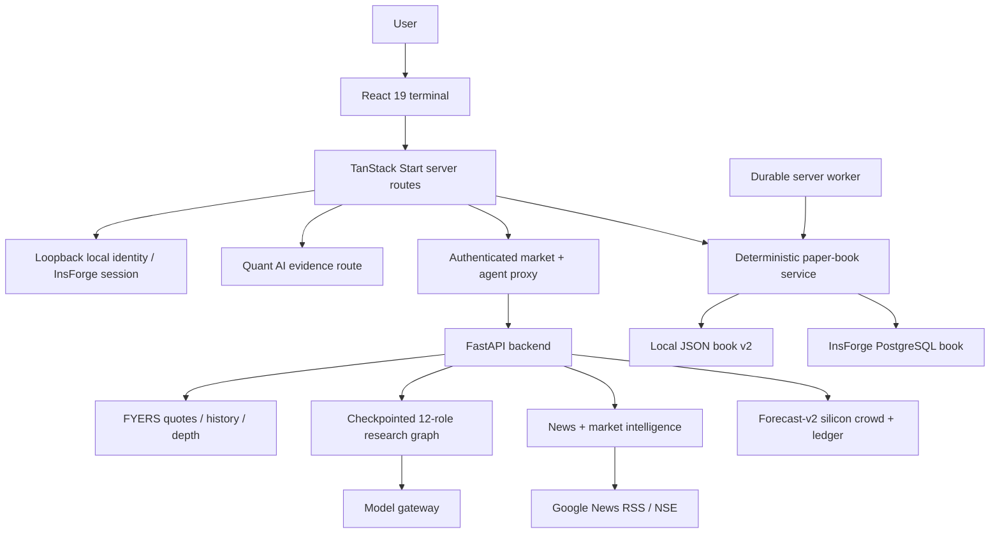
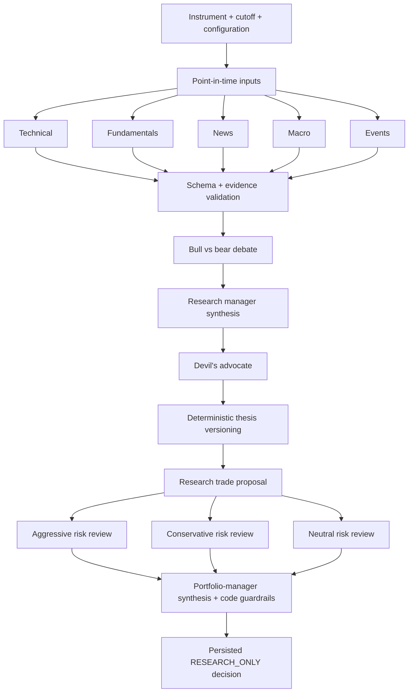
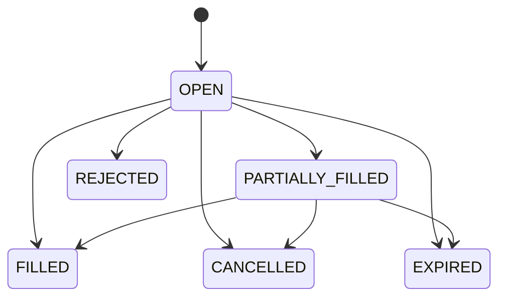

# Quant Plus — Complete Status

**Document snapshot:** 11 November 2026
**Last recorded operational evidence:** 7 November 2026 (the forecast ledger has not been re-read for this document)
**Repository:** `D:\Quant-Plus` (frontend + server + Python extension). The research/agent backend is the separately installed service at `D:\QP\agent-service`.
**Purpose of this document:** one place that records what Quant Plus is, everything that has been built, the technology and design used, how the agentic AI system actually works (the logic, not the marketing), what it produced, what failed, why it failed, and what remains open.

> **How to read the status labels**
>
> - **Implemented** — a user path exists in the current checkout with a concrete code/data path and (usually) test evidence.
> - **Partial / conditional** — the path exists but depends on a provider, credential, data coverage, or is narrower than the surrounding product language.
> - **Gated / unavailable** — the product explicitly refuses, disables, or labels the capability unavailable.
> - **Recorded result** — a measurement copied from a dated artifact. Test counts and benchmarks are not additive across dates.
>
> Nothing in this document is an investment-return claim, an accuracy claim, or a "profitable AI" claim. Where numbers exist, their date and sample size are stated.

---

## Contents

1. [Executive summary](#1-executive-summary)
2. [What Quant Plus is](#2-what-quant-plus-is)
3. [Build timeline](#3-build-timeline)
4. [System design](#4-system-design)
5. [Technology stack](#5-technology-stack)
6. [Complete feature inventory](#6-complete-feature-inventory)
7. [The agentic AI system — part 1: the research committee](#7-the-agentic-ai-system--part-1-the-research-committee)
8. [The agentic AI system — part 2: the forecast-v2 silicon crowd](#8-the-agentic-ai-system--part-2-the-forecast-v2-silicon-crowd)
9. [The agentic AI system — part 3: Quant AI copilot](#9-the-agentic-ai-system--part-3-quant-ai-copilot)
10. [The logic used across the platform](#10-the-logic-used-across-the-platform)
11. [What we got — measured engineering results](#11-what-we-got--measured-engineering-results)
12. [What failed, and why](#12-what-failed-and-why)
13. [The agentic AI post-mortem in one place](#13-the-agentic-ai-post-mortem-in-one-place)
14. [Data integrity and provenance rules](#14-data-integrity-and-provenance-rules)
15. [Verification and how to run everything](#15-verification-and-how-to-run-everything)
16. [Current limitations and claims we must not make](#16-current-limitations-and-claims-we-must-not-make)
17. [Remaining roadmap and next actions](#17-remaining-roadmap-and-next-actions)
18. [Appendix A — repository map](#appendix-a--repository-map)
19. [Appendix B — configuration flags](#appendix-b--configuration-flags)
20. [Appendix C — glossary](#appendix-c--glossary)

---

## 1. Executive summary

Quant Plus is an **evidence-aware agentic research and paper-practice terminal for Indian equities**. It connects six things that are normally sold separately:

```text
Observe → Investigate → Challenge → Understand risk → Practise → Record → Review
```

The platform is real and substantial: a live NSE market terminal, a checkpointed multi-agent research graph, a news-and-sentiment intelligence engine, a deterministic paper-trading book with exchange-grade accounting, a read-only grounded copilot, a Ripple Engine for second-order news effects, a learning wing, and a research-memory layer.

**The engineering claim is strong. The prediction claim is deliberately absent.**

- The recorded historical single-stock AI evaluations **did not beat a constant baseline** (11 reports, accuracy 5.9%–50.0%, 0/11 beats). One apparent 100% run was found to be oracle-contaminated and is quarantined as `DO_NOT_USE`.
- The current forecast-v2 system therefore stopped producing "BUY/SELL confidence". It produces **probability, distribution ranges, abstentions, falsifiers and a hash-chained forward ledger**, and it refuses to translate forecasts into paper orders until a settled-evidence gate clears.
- That gate is currently **HALT**: at the last recorded read there were ~320 locked forecast cards but only **2 settled outcomes** (1 scored). HALT is the correct state, not a bug.
- Realised paper P&L from the forecast path is **₹0**, by design. Nothing was weakened to manufacture a profitable-looking result.

**Where the project genuinely stands:** the machine that measures an edge is built, audited, tested and running. The edge itself is unproven, and the arithmetic of Indian delivery costs (≈0.4% round trip) versus a realistic daily-signal IC (0.02–0.05, ≈0.2% per trade) says it may never clear that wall. The system is designed to find that out honestly instead of hiding it.

---

## 2. What Quant Plus is

### 2.1 The one-sentence product

> A research operating system for Indian equities that moves a user from market observation to an inspectable thesis, from thesis to a risk-aware paper decision, and from outcome to measurable learning.

### 2.2 The problem

Researching a stock in India is fragmented:

```text
Prices in one app · charts in another · news somewhere else
fundamentals in documents · notes in a spreadsheet
risk in the user's head · review never
```

That makes it impossible to answer the questions that actually matter:

- What did the system know at the time?
- Which evidence supported the thesis?
- What did the opposing case say?
- What would invalidate the idea?
- How much risk did the order carry?
- Was the fill based on a real, fresh, observed quote?
- What happened to cash, reservations, charges and settlement?
- Was the mistake in the thesis, the execution, or the process?

### 2.3 The five product principles

1. **Understand before acting.**
2. **Debate instead of trusting one opinion.**
3. **Separate intelligence from authority** — AI may propose, explain and challenge; deterministic code owns money.
4. **Make paper practice financially meaningful** — reservations, partial fills, itemised charges, T+1 settlement, ledger history.
5. **Preserve the path, not only the conclusion** — source, cutoff, reasoning, decision plan, quote observation, fill, charges, journal, review.

### 2.4 Who it serves

Serious self-directed investors and learners; students and new market participants; quantitative/AI researchers; process-focused paper traders; reviewers and educators who want to inspect agent orchestration, provenance and a deterministic financial state machine.

### 2.5 Scope boundaries (by design)

- **Paper trading only.** FYERS supplies market observations; no broker order is ever submitted. SEBI's retail-algo regime makes live execution a different product with different obligations.
- **NSE cash-equity delivery only.** Options, futures, BSE and global tradeables are gated.
- **Research-only AI.** No model can mutate a balance, place an order, or silently change a risk limit.

---

## 3. Build timeline

| Date | Milestone |
| --- | --- |
| 2026-09-08 → 2026-09-18 | Repository foundation; early Lovable-generated screens, routes and sidebar/palette work. |
| 2026-10-06 | "Wired all 5 feature tasks"; first substantial feature pass. |
| 2026-10-09 → 2026-10-10 | Route/sidebar/palette build-out; README. |
| 2026-10-14 | **Deep audit** (43 findings, 10 reproduced behaviours); engine-v2 checkpoint (integer-paise book v2, verified exchange calendar, DAY expiry, marked loss window, migration/quarantine); InsForge project linked. |
| 2026-10-15 | Roadmap implementation checkpoint (local book v2 + InsForge live-verified). |
| 2026-10-17 | Product workspace completed; InsForge cutover hardened. |
| 2026-10-18 | **Ripple Engine**; **Learn wing** (Investor DNA, licence, "Be the Company", BKT AI tutor); landing-site refresh; endgame plan. |
| 2026-10-19 | Intelligence + prediction responsiveness integration; live-feed coverage; 29/29 live InsForge isolation; 49 Playwright tests. |
| 2026-10-20 | **Forecast-v2 system** (10 moves + wildcards), frontend Forecast Card, forecast ledger, jobs. |
| 2026-10-23 | Checkpoint of the whole build. |
| 2026-10-27/28 | FYERS quota gateway, shared-socket recovery, closed-session repairs, structure-board budget fix; LLM provider cut-over to Experiential Labs `gpt-6-luna`. |
| 2026-11-01 | **Mercury-3 / Inception** provider cut-over; first-ever settlements; first full 100-card batch; first sector tournament; **profitability bridge** (HALT); scheduler registered and executed; universe widened 50 → 100. |
| 2026-11-03 | Scheduler self-correction after missed Monday; intraday veto; evening watcher. |
| 2026-11-05 | **Pre-registered shadow paper-P&L stream**; evening catch-up task (`daily → settle → paper`). |
| 2026-11-06/07 | Batch D lost to machine sleep; workbook rebuilt (317 cards priced); research deliverable on how quant platforms actually make money. |
| 2026-11-11 | This status document. |

Git history is short and checkpoint-style (`36c0c96 2026-11-01`, `aef51bf 2026-10-23`, `918470b 2026-10-19`, …). Published Lovable history must not be rewritten (see `AGENTS.md`).

---

## 4. System design

### 4.1 The three planes and the authority boundary

This is the spine of the whole product.

| Plane | Responsibility | Who owns it |
| --- | --- | --- |
| **Observation** | Quotes, candles, news, documents, timestamps, data quality | Providers + validation/provenance code |
| **Research** | Specialist reasoning, debate, explanations, hypotheses, evaluation | Agentic research graph + research memory |
| **Paper-account execution** | Intent, risk, orders, fills, charges, settlement, balances | Deterministic server-side paper-book service |

A persuasive model response cannot silently become an order. That is enforced by architecture, not by prompt text: the copilot's tools are read-only, the research graph emits `RESEARCH_ONLY`, and order mutations only exist inside the paper-book service.

### 4.2 High-level architecture



### 4.3 Frontend and server

- React 19 + TypeScript.
- TanStack Router + TanStack Start (server routes) + TanStack Query.
- Vite 8, Nitro Node-server output.
- Tailwind CSS 4, Radix UI primitives, `lucide-react`, `sonner`, `vaul`, `cmdk`.
- Lightweight Charts 5 for candles; Recharts for analytics.
- Zod schemas at the local-store boundary.
- Playwright for browser coverage; Node's test runner for domain tests.

### 4.4 Backend research/intelligence service (FastAPI)

- Pydantic contracts, FYERS client/stream, yfinance PIT provider.
- Checkpointed research graph with a model gateway (key selection, pacing, bounded retry, rate-limit handling, usage accounting, body-policy adaptation).
- `quantplus_intelligence` package (versioned in this repo under `backend-extension/`, installed into the backend by `scripts/install-intelligence-backend.py`):
  - market/news/sentiment engines,
  - shared live feed and baselines,
  - history/calibration,
  - `forecast/` (the v2 system),
  - API modules (`api.py`, `forecast_api.py`, `terminal_api.py`).
- SQLite for durable intelligence history and the forecast ledger; Parquet for research datasets.

### 4.5 Persistence: two deliberate modes

| Mode | What it is | Status |
| --- | --- | --- |
| **Local workspace** | Single-profile JSON book, v2 schema, integer paise, writer lock, atomic fsync replacement, backups, migration/repair reports, reconciliation | Default and authoritative for browser tests |
| **Hosted InsForge** | PostgreSQL book, owner-scoped RLS, compare-and-swap commits, server-owned settlement, imported owner book | Implemented and live-verified twice (29/29); cut-over flags exist; final operator readback gate remains |

The two modes share the same engine and commands. Hosted mode **fails closed** — it never silently falls back to the loopback identity.

### 4.6 Information architecture

Five primary areas, plus a learning wing:

```text
Home · Learn · Discover · Portfolio · Review · More
```

The stock workspace is the centre of gravity and is opened contextually from Discover, search, watchlist, alerts, portfolio or an AI answer. Roughly 30 legacy routes remain reachable as secondary destinations or aliases; Options is deliberately kept out of the sidebar and renders as unavailable.

### 4.7 Security posture

- Provider/model credentials remain server-side; `VITE_*` never carries secrets.
- The browser calls only authenticated server routes; it never calls FYERS, NSE, Google or the model gateway directly.
- Paper mutations cross an authenticated server boundary that fetches the execution quote itself and ignores browser-supplied prices.
- Backend middleware protects legacy HTTP/WebSocket routes; only exact health GETs and state-validated FYERS callbacks are public.
- Offline mode refuses all mutations and shows a dated read-only snapshot.

---

## 5. Technology stack

| Layer | Technology |
| --- | --- |
| UI | React 19.2, TypeScript 5.8, Tailwind 4, Radix UI, Lightweight Charts 5.0.9, Recharts, GSAP, cmdk |
| App framework | TanStack Router 1.170, TanStack Start 1.168, TanStack Query 5, Vite 8, Nitro |
| Server | TanStack Start server routes (`src/routes/api/*`), Node server with a leased paper worker |
| Auth | Local loopback profile; InsForge email/password sessions with HttpOnly refresh cookies |
| Market data | FYERS (quotes, stream, OHLCV, depth, circuits) with labelled Yahoo fallback |
| News | Google News RSS (Indian locale), NSE announcement metadata, bounded official attachments |
| Research backend | FastAPI, Pydantic, yfinance PIT provider, SQLite, Parquet |
| Models | OpenRouter Nemotron (original) → Experiential Labs `gpt-6-luna` (2026-10-28) → Inception **Mercury-3** (2026-11-01, top precedence) |
| Storage | Local JSON book v2; InsForge PostgreSQL (RLS + CAS); SQLite forecast ledger (WAL) |
| Testing | Node test runner, custom `.mjs` suites, pytest, Playwright + axe-core |
| Ops | Windows Task Scheduler jobs, Python watchers, benchmark/soak/restore-drill scripts |

---

## 6. Complete feature inventory

Status is per the current checkout. "Implemented" does not mean a provider is configured today or a statistical/quality gate has passed.

### 6.1 Public site and account entry

- Public surfaces: `/` (hero, ticker, process story, dashboard reveal, capabilities, coverage, philosophy, showcase, CTA), `/markets`, `/platform`, `/research`, `/ai`, `/auth`.
- Authenticated `/app/*` guarded by `getWorkspaceSession()`; missing session redirects to `/auth`.

### 6.2 Home / Today

- Three-question dashboard: **Money** (wallet + portfolio snapshot), **Market** (index tape, overview, sentiment, calendar), **Next actions**.
- Next-actions feed assembled from open plans, triggered alerts, holdings with events, unfinished research, behavioural warnings; every item deep-links.
- Onboarding checklist derived from real activity (fund wallet → make a paper or watch-only decision → set an alert → review it), not click-through.
- Workspace modes: Learner, Trader, Researcher, Portfolio manager, Custom; selectable panel layouts.
- Universal command search (Ctrl-K): pages, symbols, evidence claims, orders, plans, news, saved research.
- Focus mode, calm density, low-bandwidth mode, review gate, attention budget.
- Offline read-only snapshot of portfolio + research.

### 6.3 Learn & Practise

- **Learning path** with investor profile, risk capacity/tolerance, concepts, AI tutoring and concept checks.
- **Investor DNA**: stated profile (capacity) vs revealed profile (behaviour from paper history) and the gap between them.
- **Trading licence**: four levels earned by discipline (stop-loss on every trade, risk < 2%, survive a simulated crash, respect stops in 5 closed planned trades); unlocks are practice risk limits, not asset access.
- **Be the Company**: 8-quarter chai-brand simulation — equity raise, IPO, results vs expectations, dilution, share-price reaction.
- **AI tutor**: Bayesian Knowledge Tracing over 14 concepts, Socratic chat, English/Hindi, uses the learner's own trades.
- **Time Machine**: links into blind replay (curated crisis scripts are partial).
- **Daily ripple lesson**: "Today's ripple question".

### 6.4 Discover

- **Market pulse**: provider-backed NIFTY/Bank Nifty/index history, breadth, drivers; keeps the constituent board usable when the index feed is unavailable.
- **NIFTY 50 board**: search, sector filter, sorting, per-row source/timestamp/freshness (live/delayed/closed/stale), breadth counters, strongest/weakest movers; one shared quote stream.
- **Stock search**: NIFTY 500 catalog plus provider-validated symbols beyond it; explicit lookup failures.
- **Watchlists**: persistent, streaming, All/Gainers/Decliners, unknown ≠ zero.
- **Screener**: sector, provider-backed momentum, volatility, opinion strength; saved screens carry the factor-formula version and warn when the formula changed.
- **Event Radar**: exchange/calendar events, classified news, expiries, computed T+1 settlement dates, holdings-only filter, historical reaction, knowability-at-trade-time.
- **Market Context / Regime Map**: observable features, nearest historical analogs, forward-return distributions, breadth/news/sector context, explicit unavailable FII/DII; context, never forecast.
- **Research briefs**: market intelligence + completed analyses in one filtered terminal.
- **Ripple map**: the flagship news-propagation surface.
- **Options**: route exists, renders **unavailable** until observed chains, lot/expiry rules and Greeks exist.

### 6.5 Stock workspace

- **Quote header**: price, change, source, provider timestamp, session state, live/closed/delayed/stale; missing values render as `—`.
- **Professional chart**: 1D–1Y, candles/line/area, volume, MA20/EMA50/RSI14 with warm-up states, crosshair, zoom, pan, keyboard bar navigation, NSE/calendar event markers, the user's own decisions/journals plotted, browser-local chart notes.
- **Technical/fundamental facts**: momentum, volatility, RSI, market cap, P/E, dividend yield, beta, 52-week range — only when the provider returned them.
- **Market microstructure**: bid/ask, displayed depth, circuits, traded volume, snapshot age, explicit "no five-level depth on fallback".
- **Stock news intelligence**: weighted score, positive/neutral/negative counts, confidence, data quality, high-impact stories, top drivers, price confirmation/divergence, "Not scored" badges.
- **Decision Canvas**: Evidence → Thesis → Risk → Paper trade / watch-only → Review, with current thesis, counter-case and quote evidence.
- **Forecast Card** (v2): probability + ranges + abstention, evidence/sector panel, live tripwires, personal fit; 5D/20D toggle; ledger footer (locked/scored/Brier skill/chain verified).
- **Paper order ticket**: BUY/SELL, MARKET/LIMIT/STOP, quantity, stop, target, holding period, plan link, live risk preview, confirmation threshold, explicit last-session practice when closed.

### 6.6 AI research committee (see §7 for internals)

- Start/resume a checkpointed research session; poll stage progress; keep previous completed research visible during refresh; retry failed stages.
- Investment Committee and Agent Activity views read the same persisted session (analyst findings + saved stage events).
- Committee decision queue/history with verdict, risk labels, rationale, **uncalibrated opinion strength**, browser-local triage labels.
- UI explicitly records that none of 11 evaluated configurations beat a constant baseline.

### 6.7 Quant AI copilot (see §9 for internals)

- Full page with task modes: general, explain a move, compare evidence, portfolio risk, pre-trade review, journal review, post-trade review.
- Streaming, stop/retry/new, saved/searchable/exportable conversations.
- Contextual dock available across the app, auto-attaching the viewed symbol.
- Read-only by construction; server-buffered answer, numeric/citation validation, abstention.

### 6.8 Ripple Engine

- Curated relationship graph over NIFTY 50 + 14 macro factors (curated, not extracted from filings yet).
- Verified ripple origins from dated, recent, non-future news; factor/direction/impact/confidence; lock time.
- Propagation across stock ↔ sector ↔ factor ↔ commodity ↔ currency ↔ rates ↔ macro edges with hop/time decay; strongest explainable path kept, loops avoided.
- Historical echo only when aligned sessions and non-overlapping windows exist.
- Every ripple call is locked and graded after 3 sessions against an always-up baseline; displayed on the Ripple page and Review → Track Record as "Ripple Engine".
- "What moves this stock" panel on stock pages.
- Plain-language/Hindi explanation via the grounded copilot.

### 6.9 Portfolio, wallet and execution

- **Wallet**: virtual deposits/withdrawals with idempotent intent IDs, paginated ledger, settled vs unsettled vs withdrawable cash, reservations, deployed capital, realised P&L with charges.
- **Portfolio**: provider-marked holdings, current/invested value, unrealised P&L, allocation, contribution, sector exposure, concentration posture, stale/delayed/missing warnings, upcoming events, unprotected holdings, open plans.
- **Orders**: paginated ledger, every state, fill counts, charges, expiry, protections, check-fill, cancel, amend, and **per-order execution audit** (intent, fills, reference price, fill method, liquidity limit, quote timestamp/source, itemised charges, ledger entries, reservations, event sequence, JSON export).
- **Order management**: amendments require a fresh quote + version check; separate-order OCO stop/target for existing holdings (fill one, sibling cancels).
- **Baskets**: up to 20 legs, server-side quote preflight against a copied book, per-leg status, safe retry with original intent IDs.
- **Alerts**: price/percentage, enable/disable, one-shot + re-arm, delete, delivery history with observed price and provider time.
- **Risk Centre**: server-computed day P&L and loss window anchored to session start, stale marks, cash flows, deterministic stress, max order value, max position %, confirmation threshold, daily loss limit, pause-new-exposure. **Risk-reducing exits are never blocked.**
- **Exposure / X-ray**: contribution, VaR, beta, effective positions, drawdown, stress, risk contribution, marginal risk, liquidity/exit days, gap loss, sector weights, correlation clusters, cash/event runway, digital-twin what-if.
- **Trading Habits**: consent-based detection of size-up-after-loss, rapid re-entry, moved stops, ignored invalidation, repeated process failure; cooling-off, daily decision limit, drawdown sizing cap, thesis reminder — applied to entries only, never exits.

### 6.10 Review and research memory

- **Review Hub**: triage queue — invalidated thesis not reflected, outcome not reviewed, holding period elapsed, open linked order, unreviewed no-trade decision.
- **Decision Journal**: thesis, evidence, risks, invalidation, planned exit, reflection, outcome, linked order, immutable decision-time quote snapshot.
- **Decision Plans**: expected outcome, thesis, counter-thesis, invalidation, typed evidence with published/available times, entry/stop/target/time exit, holding period, quantity, risk-based sizing, expected fees/slippage, max acceptable loss, market snapshot, risk preview, trade/no-trade, linked order, revision history, JSON export.
- **Outcome attribution**: thesis quality vs execution quality vs process quality.
- **Replay**: random hidden start, future bars/news hidden, decision/execution/risk/news/blind modes, latency/participation/spread/partial fills, gap-through-stop, separate replay wallet, buy-and-hold comparison, saved to research memory.
- **Track Record**: matures committee forecasts by horizon vs constant baseline; accuracy, Brier, abstentions, calibration; segments by role/regime/sector/liquidity/coverage/model version; compares AI decisions with plans, initial thesis and execution. Also hosts the **forecast ledger section** (Brier skill, log-loss, CRPS, 80% coverage, calibration table, coverage curve, per-forecaster skill, tournament IC gate, chain status).
- **Strategy Lab**: plain-language hypothesis → typed strategy DSL (unparsed clauses shown), then baseline / walk-forward / cost / placebo / sensitivity / regime / concentration / data-quality / shadow checks; versioned studies.
- **Research Network**: versioned memos with cutoff, horizon, maturity, thesis, evidence, assumptions, falsifiers, review status, revision history, SHA-256 export/import bundles, matured-forecast leaderboard. Team collaboration is explicitly **gated**.

### 6.11 System pages

- **Data Status / Trust Control Room**: quote coverage/freshness/field completeness, provider status, news status, research freshness, copilot config/usage, worker heartbeat, reconciliation, backups, fallbacks, reconnects, and a named list of deliberately unavailable capabilities.
- **Capabilities / Roadmap**: delivered / partial / blocked for options, futures, BSE/global, corporate-action accounting, collaboration.
- **Settings**: display name, density, calm mode, ticket defaults, chart type, volume, notifications, focus/review/low-bandwidth, attention budget, sector-concentration policy, workspace mode — persisted through reloads.
- **Help**: searchable FAQs, truthful "no support channel configured".

### 6.12 InsForge migration

- Schema/migrations, owner-scoped RLS, admin-only compare-and-swap commit, hosted adapter, imported owner book, shared deterministic commands.
- Live two-user isolation runs: **29/29 checks passed** on 2026-10-14 and again on 2026-10-19 (throwaway users deleted, email verification restored).
- A real bug found by the first run: the live session endpoint returned no `role`, so every real user had been rejected.
- Activation requires `QUANT_PLUS_BOOK_PROVIDER=insforge` **and** `VITE_QUANT_PLUS_AUTH=insforge`; final worker-closed-browser run and operator readback remain.

---

## 7. The agentic AI system — part 1: the research committee

This is the original 12-role graph. It produces research artifacts, not orders.

### 7.1 Why multiple roles

A stock thesis combines evidence types that genuinely disagree: price may improve while fundamentals weaken; news may sound positive while price falls; a stock may look good alone while the portfolio is already concentrated; an event may invalidate a technical setup. Role separation creates **inspectable disagreement** instead of one blended paragraph. It does not create statistical independence between agents, and several model opinions are not automatically more accurate than one.

### 7.2 Graph



### 7.3 Role responsibilities

| Role | Responsibility |
| --- | --- |
| Technical analyst | Deterministic price/volume features, trend, momentum, exhaustion, available structure |
| Fundamentals analyst | Available fundamental evidence within source/period/provenance limits |
| News analyst | Relevant available news/announcements without treating prose numbers as verified facts |
| Macro analyst | Index, volatility, breadth and macro context where data exists |
| Events analyst | Known announcements/scheduled events with an explicit availability cutoff |
| Bull / bear | Build and rebut opposing cases from the analyst evidence ledger; bounded (2 rounds default) |
| Research manager | Synthesise the weight of evidence into a structured thesis + mechanism classification |
| Devil's advocate | Challenge the thesis; separate repeated risks from new contradictions; verdict healthy/broken |
| Trader | Research proposal from thesis, challenge and optional portfolio context |
| Risk reviewers | Aggressive / conservative / neutral, run concurrently, synthesised by governance rules |
| Portfolio manager | Final research decision; governance labels applied by code, not the model |
| Research-OS roles | Factor, Microstructure, Regime/Risk, Event/Fundamental, Failure Analysis, Research Director, Falsification |

### 7.4 What makes it agentic (and what does not)

Agentic here means: a bounded workflow of specialised roles, shared typed inputs, concurrent specialist work, checkpoints, retries, debate, challenge, multi-perspective risk review, and a persisted artifact. It is **not** an autonomous capital manager and not a self-directing loop.

### 7.5 Grounding and validation

- Outputs are typed schemas, not free prose only.
- Numeric signals and references are checked against supplied facts.
- Invalid claims trigger a correction retry, then failure before synthesis.
- Tested mistake classes: wrong sign, wrong unit, wrong field, wrong reference, unsupported number, cross-instrument substitution.
- Governance labels (`RESEARCH_ONLY`, restrictions) are code-owned; a model cannot replace them.
- Known gap: qualitative assertions are not fully provable, and a single immutable evidence bundle shared by every stage remains on the roadmap.

### 7.6 Checkpoints, identity and recovery

- Session identity is deterministic from instrument + cutoff + configuration (+ portfolio fingerprint where applicable).
- Completed stages are persisted and reused only when evidence/config match.
- Retry resumes around the failed stage; a thesis version is minted idempotently per session.
- Completed research stays visible and labelled during refresh; results older than the max age are not served.
- Runs have a wall-clock deadline and bounded debate/risk stages.

### 7.7 Operations

- Warm worker: HDFCBANK, RELIANCE, TCS, INFY, ICICIBANK by default; one warm job at a time; same-stock jobs coalesce; warming stops at 50% of the daily budget, never raising the cap.
- Measured warm retrieval (100 in-process reads of a completed HDFCBANK result): median **2.594 ms**, p95 **4.829 ms**, max **7.017 ms**, **0 model calls**, 5 analyst reports. Saved full runs previously took **430.77 s** and **980.65 s** — delivery speed, not analysis speed.
- Model routing history: OpenRouter `nvidia/nemotron-3-ultra-550b-a55b:free` → Experiential Labs `gpt-6-luna` (2026-10-28) → Inception **Mercury-3** (2026-11-01, top precedence, temperature 0.7). These are recorded configuration identifiers; private runtime settings can override them and the gateway's underlying model identity is not independently certified. Daily request cap moved 50 → 300 → 3000.
- Verified live run (2026-10-28, TCS): **18/18 LLM calls succeeded, 20,520 tokens, 67 s**, zero 400s/retries/quarantines, governance flags intact.

---

## 8. The agentic AI system — part 2: the forecast-v2 silicon crowd

This is the current prediction system and the most important part of the "agentic AI" story. It was built **because** the 12-role committee could not demonstrate directional edge.

Design blueprint: `research_notes/Agentic Recommendation Redesign/blueprint.md` (10 moves + wildcards).
Code: `backend-extension/quantplus_intelligence/forecast/`.

### 8.1 The core shift

| Old system | Forecast-v2 |
| --- | --- |
| One committee, one blended opinion | A crowd of independent forecasters with **different information diets** |
| "Conviction" prose | `P(outperform)` + return quantiles + volatility + event-shock probability |
| Always answers | Explicit **abstention** with a reason |
| No outcome registry | **Hash-chained, forward-only ledger**, settled exactly once |
| Accuracy only | Brier / log-loss / CRPS / skill / reliability / coverage / rank IC |
| Opinion → order | Gate → half-Kelly intent, and only after ≥30 settled cards |
| "Why?" narrative | Machine-checkable **falsifiers** (`close < 2810.5`, `vix_pct >= 0.85`, `event:auditor_resign`) |

Authority is a schema invariant: `AUTHORITY = "RESEARCH_ONLY"`, enforced in `ForecastCard.__post_init__`. A card with any other authority cannot be constructed.

### 8.2 Forecast Card contract (`schema.py`)

- Fields: `symbol`, `as_of` (ISO UTC evidence cutoff — nothing later may be used), `horizon` (5 or 20 sessions), `benchmark` (`NIFTY50` or `SECTOR`), `p_outperform`, `quantiles` (0.1/0.5/0.9 excess return), `vol_forecast`, `p_event_shock`, `abstain` + reason, `contributions`, `disagreement`, `robustness`, `blind`, `falsifiers`, `evidence_refs`, `model_version` (`forecast-v2-horizon-gated`), `authority`.
- Validation: horizon ∈ {5,20}; benchmark ∈ {NIFTY50, SECTOR}; an abstention must state why; `p` ∈ [0,1] unless abstaining; quantiles non-decreasing.
- `card_id` = SHA-256 of the canonical payload (first 24 hex chars) — a content address, so an identical forecast reuses one id and any change mints a new one.

### 8.3 Evidence slices (`evidence.py`)

Deterministic features are computed **in code**, never by the model:

- `ret_5d/20d/60d`, `excess_ret_5d/20d/60d`, sector-relative excess.
- `excess_vol_20d`, `trend_consistency_20d/60d`, `vol_20d`.
- `dist_hi20`, `dist_lo20`, `range_position_20d`.
- `volx` (last volume / 20-day average).
- Ticker-own **exhaustion threshold** (80th percentile of historical |5d return|), `blowoff_flag`, `flush_flag`.

Five diets: `technical`, `relative`, `events`, `news`, `flows`. Each forecaster sees only its slice.

**Blindfold:** blind mode replaces the ticker/company names with "Company A", scrubs dates to `[date]`, and never includes `as_of`. This is a memorisation control, not decoration.

### 8.4 The crowd (`forecasters.py`)

Eight voters:

| Forecaster | Diet | Type |
| --- | --- | --- |
| technical | technical | LLM |
| relative | relative | LLM |
| events | events | LLM |
| news | news | LLM |
| flows | flows | LLM |
| generalist_blind | all five | LLM |
| momentum | classical baseline | code |
| reversal | classical baseline | code |

- The prompt fixes the base rate at 0.5, warns that most honest forecasts are 0.40–0.60, carries explicit **horizon discipline** (5-session momentum/event/exhaustion vs 20-session trend/rotation), tells the model to abstain on empty or contradictory evidence, treats headlines as untrusted data, and demands strict JSON.
- Parsing is strict: malformed JSON, out-of-range p, or a missing field becomes an **abstention**, never a coerced number.
- Forecasters run concurrently. Missing diet → abstain ("empty evidence slice"). Model error → abstain ("model unavailable"). No model configured → abstain.
- `gateway_complete()` lazily adapts the backend's existing model gateway, so tests are fully offline.

### 8.5 Aggregation logic (`aggregate.py`)

This is where the "silicon crowd" becomes one number. It is deliberately conservative:

1. Drop abstentions; require **at least 3 live votes**, otherwise the whole card abstains (`only N of M forecasters answered`).
2. **Debias** each forecaster with its measured acquiescence bias (`mean(p) - mean(y)`) once it has ≥30 settled observations. LLMs skew above 0.5; this removes the measured skew.
3. **Weight** by track record: floor **0.25** for unproven; above that, `0.25 + max(0,skill) × 10 × min(1, n/200)` where skill = 1 − Brier/climatology. Skill ≤ 0 earns only the floor.
4. **Stabilise unproven LLM confidence** into **[0.35, 0.65]**. Until a forecaster has ≥30 forward-settled observations, a confident 0.9 is treated as an unverified opinion.
5. Take the **weighted median in logit space** (robust to one loud dissenter).
6. Compute weighted **disagreement** (weighted SD around the mean probability).
7. **Extremise** only when several independent, track-recorded forecasters agree: `alpha = min(1.5, 1 + 0.1 × proven_count)` if disagreement < 0.08, else `alpha = 1.0`.

The output is `sigmoid(alpha × weighted_median_logit)`.

### 8.6 Risk-first layer (`risk.py`, `calibration.py`)

Volatility was the only thing the independent ML review marked as a pass, so ranges lead the card.

- **EWMA volatility** (RiskMetrics λ = 0.94) on daily excess returns; horizon vol = daily × √horizon.
- **Quantiles** 10/50/90 from a normal with zero drift; a **conformal margin** widens the outer band once ≥30 settled cards exist.
- **P(drawdown)** via the reflection principle, zero drift: `2·Φ(−depth/σ_h)`.
- **P(event shock)** = normal two-sigma tail (~4.6%) plus 20pp if a scheduled event falls in the horizon.
- **Regime** label from the 20-day vol percentile (STRESSED ≥ 85th, ELEVATED ≥ 50th, else CALM).
- **Isotonic calibration** is fitted on settled `(p, y)` pairs; until 50 settled forecasts the UI says `uncalibrated` and the interval says `model-based (not yet conformal)`.

### 8.7 Scoring (`scoring.py`)

Proper scoring rules, because binary accuracy on a dozen cases cannot separate skill from luck:

- **Brier**, **log loss**, **pinball**, **CRPS** from quantiles.
- **Skill** = 1 − model/reference against climatology (0.5).
- **Reliability table** (10 bins: mean forecast vs observed frequency).
- **Coverage curve**: Brier when answering only the most confident 25/50/75/100%.
- **Spearman rank IC**, mean daily IC, t-stat, and days-to-significance.
- **Interval coverage**: share of outcomes inside [10th, 90th] quantile.

### 8.8 Sector tournaments (`tournament.py`)

- Blind, name-scrubbed technical+relative blocks for peers in the same sector.
- **Plackett–Luce** ranking from repeated blind blocks (`size=6`, `rounds=3`), producing per-stock strength and `P(outperform sector)`.
- Sectors with fewer than 3 peers are skipped by design.
- Daily rank IC is computed within sector; the gate is **PASS** only when `days ≥ 45` and `t > 2`, otherwise **PENDING**, and **FAIL** after 45 days without significance.

### 8.9 Events and disclosure diffs (`events.py`, `textdiff.py`)

- Typed event library with PIT `in_window`, forward event study, admission bar (Bonferroni-style), and event priors.
- Live NSE announcement titles + results surprise/scheduled feeds populate the events slice.
- `textdiff` produces grounded labelled changes for concall diffs — **no transcript source exists yet**, so this is unwired.
- `jobs event-study` computes forward abnormal returns per disclosure type from events first seen by cards.

### 8.10 Executable falsifiers (`falsifiers.py`)

- Tiny safe DSL: field + comparison + number, or `event:<kind>`.
- Fields: `close`, `excess_ret_5d/20d`, `vol_20d`, `vix_pct`, `dist_hi20`, `dist_lo20`, `ret_5d`.
- Hard trip → **BROKEN**; soft trip → **WEAKENED**; missing observation → `None`, never guessed.
- Defaults are derived from the card's own numbers (e.g. close below the card's own 10th percentile, sharp underperformance, new promoter pledge, auditor resignation, VIX ≥ 85th percentile).
- Tripwires are re-evaluated on fresh snapshots (status route + UI, 10-minute refresh); push notifications are not wired.

### 8.11 Meta-labelling, personal fit, robustness

- **Meta-label (`metalabel.py`)**: a down-only filter over the deterministic core; refuses to train with <50 labels; compares on a holdout. Needs matured forward records (currently 0), so it is unwired.
- **Personal fit (`personal.py`)**: maps a card to conservative/balanced/aggressive practice framing from the paper book; other holdings' volatility approximated at 2%/day.
- **Robustness (`robustness.py`)**: leave-one-out vote robustness on each card; memorisation gap (named vs blind); narrative crowding (pre-registered hypothesis, not a signal).

### 8.12 The hash-chained ledger (`ledger.py`)

This is the integrity backbone.

- SQLite (WAL + 30 s busy timeout) shared by the backend and scheduled jobs.
- Each row stores `card_id` (unique), symbol, `as_of`, horizon, `matures_on`, payload, `recorded_at`, `prev_hash`, `hash`, `settled_at`, `outcome`.
- `hash = SHA-256(prev | card_id | payload | recorded_at)` — editing any payload, reordering, or backdating breaks the chain, and `verify()` recomputes it row by row.
- **Lock before outcome:** `record()` refuses a card whose outcome has already matured.
- **Maturity** counts trading sessions using the verified NSE calendar; an unverified calendar returns `None` (fail closed).
- **Exactly-once settlement:** `settle()` refuses before maturity and returns `already settled` on a repeat.
- Side tables: `forecast_extras` (votes/sources/events/crowding — diagnostics, not in the chain) and `forecast_tournaments`.
- `scoreboard()` reports recorded/settled/scored/abstained, Brier, log-loss, Brier skill vs climatology, CRPS, 80% interval coverage, reliability, coverage curve, per-forecaster skill, tournament IC gate and chain validity.

### 8.13 The profitability bridge (`bridge.py`)

The only path from a forecast to a trade intent. It owns no money and calls no model.

- Reads **settled, non-abstaining** cards only.
- Per horizon, the bullish slice is `p ≥ 0.60`.
- `long_edge = mean(realised excess of bullish) − 0.004` (0.4% conservative delivery round-trip hurdle).
- State machine: **HALT** (< 30 settled) → **WATCH** (data exists, hurdle not cleared) → **TRADE** (≥30 settled, ≥10 bullish, hit rate > 0.5, edge after costs > 0).
- If TRADE, unresolved cards above 0.60 become **RESEARCH_ONLY** intents with a half-Kelly-flavoured size: `cap × min(1, 2(p−0.5)) × 0.5`, cap 10% of paper equity, floored at 0.
- Every run re-derives from settled rows; no state persists, so a prior false TRADE cannot be re-opened by data.
- Longs only (NSE cash delivery cannot short).

### 8.14 Pre-registered shadow paper P&L (`shadow.py`)

Created to accumulate forward evidence without weakening the gate.

- Registration timestamp is line 1 of `paper_pnl.jsonl` (2026-11-05 14:02 UTC / 19:32 IST), **before** any post-registration card existed.
- Fixed rule: from the latest locked batch, per horizon, the **top-3 bullish** cards (answerable, p > 0.5; tie-break |p−0.5| desc, p desc, symbol asc), held to their own horizon.
- `net = realised excess − 0.004`, scored **only** from the main ledger's forward settlements; no price fetching, no backfill, no interim data.
- Idempotent: re-runs add nothing. Pre-registration batches (A and B) are excluded forever.
- Authority is `SHADOW — paper P&L evidence only; not the profitability gate`.

### 8.15 Inputs, universe and API

- **Universe:** `scripts/update_forecast_universe.py` fetches the official NSE `ind_nifty50list.csv` and `ind_niftynext50list.csv` and writes `data/forecast_universe.json` (provenance: retrieved_at, index, industry). Result: **100 symbols, 0 failures, 17 industries**, 9 sectors deep enough for tournaments (Financial Services 23, Capital Goods 11, Auto 9, Metals 8, Healthcare 8, FMCG 7, Oil & Gas 6, IT 6, Power 6).
- **PIT inputs:** closed-session-only price history; headlines counted only before the last close; NSE announcements; results surprise/scheduled; delivery flows. `cutoff = last completed bar's session close`.
- **Routes:** GET/POST `/api/v1/stocks/{sym}/forecast?horizon=5|20`, GET `/api/v1/stocks/{s}/forecast/status`, POST `/api/v1/stocks/{s}/forecast/personal`, GET `/api/v1/forecast/scoreboard`, POST `/api/v1/forecast/settle` (operator only, **not proxied**, browser-unreachable).
- **Frontend proxy:** allowlists GET/POST forecast + GET scoreboard; the only body-forwarding path is personal (capped 200 KB); POST timeout raised 20 s → 180 s.
- **Frontend:** `ForecastCard.tsx`, `ForecastPanels.tsx`, `ForecastLedgerSection.tsx`, `src/lib/forecast-api.ts`, `src/routes/api/forecast/$.ts`.

### 8.16 Jobs and scheduling (`jobs.py`)

| Verb | What it does |
| --- | --- |
| `daily` | Lock 5D + 20D cards for the universe; reuses a card for the same (symbol, horizon, bar); refuses while the market is open |
| `tournament` | Blind sector tournaments, stored per day/horizon/sector |
| `settle` | Settle matured cards + tournaments, append the ledger head hash to `ledger_heads.jsonl` |
| `blind-gap` | Named vs blind memorisation report |
| `risk-bench` | Volatility forecast vs naive and India VIX |
| `metalabel` | Meta-label vs deterministic core |
| `crowding` | Pre-registered crowding → volatility test |
| `event-study` | Forward abnormal returns per disclosure type |
| `paper` | Shadow paper-P&L stream |
| `catchup` | `daily → settle → paper`, idempotent, safe at 21:00 |

Windows Task Scheduler: `QPForecastSettle` 16:15, `QPForecastDaily` 16:30, `QPForecastTournament` 17:30, `QPForecastCatchup` 21:00 (Mon–Fri IST).

### 8.17 Reporting artifacts

- `reports/agentic-ai-predictions.xlsx` — tabs: **Summary, Tomorrow Brief, Predictions, Votes, Settled Results, Methodology, Diagnostics**.
- `reports/agentic-ai-predictions-tomorrow.md` — speaking brief, including the exact honest answer on accuracy.
- `reports/agentic-ai-week-results.xlsx` — tabs: **Week Summary, Week Results, Settled Actuals, Jobs Log, Paper P&L, Definitions**.
- `reports/evening-refresh-status.json` — watcher status (last written 2026-11-06 18:24).
- `data/forecast_reports/` — bridge snapshots, ledger heads, event-study/risk/metalabel/crowding reports, `paper_pnl.jsonl`.

---

## 9. The agentic AI system — part 3: Quant AI copilot

Quant AI is a **separate system** from the research graph and the forecast crowd. It is the conversational interface over application context, and it is read-only.

### 9.1 Answer pipeline

```text
Question + authenticated context
   → symbol/entity resolution
   → bounded READ-ONLY evidence collection (typed tools)
   → server-side model request (keys never reach the browser)
   → candidate answer buffered server-side
   → numeric + citation validation
   → supported answer + evidence footer, or abstention
```

### 9.2 Evidence it can collect

Paper account, holdings/exposure, risk status and loss window, recent orders, order audits, journal, market overview, stock observations, validated history-derived facts, news tone, saved research.

### 9.3 Grounding algorithm (`src/lib/copilot/grounding.ts`)

This is a real checker, not a prompt instruction:

- Extract every number from each clause (handles commas, unicode minus, sign spacing).
- Extract citation IDs `[A12]`; each number is matched to the citation that follows it.
- Resolve the field from the nearest preceding label (price, close, volume, quantity, return, change, RSI, cash, available/reserved cash, bid, ask, or a typed field name), and the entity from the clause.
- **Reject** when: the field doesn't match; the entity doesn't match; the sign is wrong; the unit is wrong (`%` on a non-percent field, "shares" on non-quantity, "rupees" on a percent/quantity field); or the value doesn't match any eligible fact within rounding tolerance.
- Unknown citation IDs are rejected.
- If anything fails, the user gets "I could not verify this answer against the cited evidence…" instead of the model's text.

### 9.4 Boundaries

- No write tools. It cannot place, amend or cancel an order.
- The system prompt states read-only behaviour, but the enforcement is architectural.
- Known gap: the checker is an engineering control, not a completed quality study. A ≥200-answer human-reviewed set and provider token/cost accounting remain open.

---

## 10. The logic used across the platform

### 10.1 Paper execution

| Question | Rule |
| --- | --- |
| Who owns the price? | The server fetches it from the provider; browser prices are ignored |
| Is a quote eligible? | Positive finite price, symbol match, correct provider, valid timestamp, not stale, not delayed, open **verified** exchange session |
| Closed market? | Accepted only with an explicit practice intent, restricted to market orders, local mode only |
| Fill price | Ask for buys / bid for sells when a valid spread exists; otherwise last trade + recorded slippage assumption |
| Liquidity | Displayed top-of-book quantity caps the fill; insufficient liquidity → partial fill, remainder of a market order cancelled |
| Money while open | Buys reserve cash; sells reserve shares; cancel/expiry releases the reservation |
| Charges | STT, exchange transaction charges, SEBI fees, stamp duty, GST, brokerage, DP — integer paise, dated fee schedule; unknown charge dates fail closed |
| Settlement | T+1: settled vs unsettled shares/cash, pending sale proceeds, withdrawable cash, clearing-day rules |
| DAY expiry | At the **verified session close** (weekends/holidays skipped), carries `expires_at`, releases reservations, emits a notification |
| Protections | Server-persisted stop/target/trailing; durable leased worker evaluates them with the browser closed (server must be running) |
| OCO | Stop and target share a reservation; filling one cancels the sibling |
| Retries | Intent ID + fingerprint; identical retry replays the response, changed details under the same intent → conflict |
| Reconciliation | cash = ledger sum; positions = remaining fills; order fills = fill records; reservations cover open obligations; event sequence unique and monotonic |

Order state machine:



### 10.2 Risk compiler and risk centre

- Reference price, fill range, turnover, spread cost, expected slippage, fees, participation %, top-of-book %, worst partial-fill quantity, position % after, sector % after, beta exposure, stop distance, planned loss, gap loss, scenario losses, daily budget usage, reward-to-risk, events in horizon, behavioural warnings.
- Policy: max order value, max position %, daily loss limit, confirmation threshold, trading pause, new-exposure limits, sector/liquidity/data-quality warnings.
- Loss window: anchored from prior closing marks (`PRIOR_CLOSE_MARKS`) or the first mutation; loss = anchor + same-day cash flows − marked equity, so unrealised drops count and deposits do not hide losses. Stale positions carry the last provider mark and are labelled stale.
- Exits that reduce risk are always allowed; only new exposure is restricted.

### 10.3 Market sentiment composite

Deterministic, centrally configured weights summing to 1.0:

| Component | Weight |
| --- | ---: |
| NIFTY momentum | 20% |
| Market breadth | 20% |
| Sector breadth | 15% |
| India VIX | 15% |
| News sentiment | 15% |
| Relative volume momentum | 10% |
| Bank Nifty confirmation | 5% |

- Missing components get zero effective weight; remaining weights renormalise; confidence falls with coverage.
- Breadth requires 80% constituent coverage; volume requires ≥10 usable samples; VIX uses daily direction + rate of change + completed-session average.
- Quality is `GOOD` only when required components are complete; a news-only result cannot masquerade as a quantitative index.
- Optional regime-aware weighting is bounded, disabled by default, and exposes base vs effective weights.
- The AI narrative explains the number but **cannot change it**; driver/risk numbers are rendered in code from validated evidence IDs.

### 10.4 News → sentiment → ripple

- Google News RSS with Indian locale; search window now matches the 48 h age filter (`when:2d`).
- Dedup: deterministic IDs + normalised headlines + fuzzy > 0.88, preserving different numbers and directional developments.
- Relevance threshold 55; age decay 12 h half-life; impact from event category, source, age, relevance, magnitude, optional price reaction.
- Conservative stock-context rules (oil producers vs consumers), ambiguous sentiment shrunk toward neutral, confidence exposed.
- Unsupported language is explicitly unavailable, never invented neutral.
- Ripple origins require dated, recent, non-future news + a usable provider snapshot; ambiguous/prospective moves rejected; history echoes require aligned sessions and non-overlapping windows; link weights are labelled **curated**, not probabilities.

### 10.5 Decision plans, review and research memory

- Plan revision history records changes to entry/stop/target/time exit/holding period/quantity.
- Market snapshot and evidence availability times are frozen at plan creation.
- Outcome attribution separates thesis / execution / process quality (e.g. "profitable trade, bad process").
- Track Record matures forecasts by horizon, compares against a constant baseline, reports accuracy/Brier/calibration/abstentions by segment.
- Strategy Lab runs the fraud-catching sequence: baseline → walk-forward → costs → placebo → sensitivity → regime → concentration → data quality → shadow.
- Replay hides future bars/news, uses a separate wallet, models latency/participation/spread/partial fills, and compares against buy-and-hold.

---

## 11. What we got — measured engineering results

All figures are recorded artifacts with dates. **These are engineering results, not investment returns.**

### 11.1 Automated verification (latest recorded per suite)

| Check | Recorded result | Date |
| --- | --- | --- |
| `npm test` (unit + 20 script suites) | 74 unit cases + full local paper/auth/settlement/fault/migration/worker/decision-plan chain | 2026-10-19 |
| `npm run test:intelligence` | 316 passed | 2026-10-19 |
| `npm run test:backend` | 473 passed | 2026-10-19 |
| Playwright browser coverage | 49 passed (canonical routes, a11y, local flows) | 2026-10-19 |
| Backend-extension suite | 454 passed (hermetic, external HTTP disabled) | 2026-11-01 |
| Agent-service suite | 488 passed | 2026-10-27 |
| Focused forecast suites | 43 passed (system + bridge + paper) | 2026-11-05 |
| Typecheck / lint / build | Pass each recorded checkpoint; 7 Fast Refresh warnings remain | ongoing |
| Live InsForge two-user isolation | **29/29** passed (twice) | 2026-10-14, 2026-10-19 |

Counts are different units and different dates; do not add them into one "total".

### 11.2 Performance benchmarks

Completed-research retrieval (100 in-process reads, HDFCBANK, isolated DB):

| Metric | Result |
| --- | ---: |
| Median | 2.594 ms |
| p95 | 4.829 ms |
| Maximum | 7.017 ms |
| Model calls | 0 |
| Analyst reports returned | 5 |

Local paper book (recorded run):

| Operation | p50 | p95 |
| --- | ---: | ---: |
| Resting-limit acknowledgement | 146.227 ms | 253.721 ms |
| Holdings read | 18.231 ms | 24.480 ms |
| Account read | 17.991 ms | 23.786 ms |
| Orders page read | 18.004 ms | 23.272 ms |
| Worker tick | 31.500 ms | 40.774 ms |

Accelerated soak: 10 simulated sessions, 130 iterations, 121 requests, 31 DAY-order expiries, 10 per-session expiry proofs, **0** server/reconciliation/duplicate-settlement errors, route p95 **254.9 ms**.

### 11.3 Live intelligence

Recorded 2026-10-19 13:55 IST during `OPEN`:

- NIFTY breadth **50/50**; sector breadth **8/8**; fresh India VIX.
- Volume **12** usable samples (minimum 10).
- Composite components **7/7**, weight coverage 1.0.
- Data quality **GOOD / 99**.

Structure-board repair (2026-10-27, closed session): cold burst 42 FYERS / 8 Yahoo → after TTL **50 FYERS / 0 Yahoo** → cache hit 50/50 with zero calls. All rows `GOOD`.

### 11.4 Forecast ledger (the honest core of the AI result)

State at the last recorded read (2026-11-06/07):

| Item | Value |
| --- | --- |
| Locked cards | ~317–320 (documents differ by three; the Nov 6 export counted **317**) |
| Batch A (cutoff 2026-10-30) | 100 cards |
| Batch B (cutoff 2026-11-02) | 200 cards |
| Batch C (cutoff 2026-11-04) | 17 (partial) |
| Settled outcomes | **2** |
| Scored (non-abstaining) forecasts | **1** |
| Answerable vs abstaining (latest 200-card snapshot) | 12/88 at 5D, 11/89 at 20D |
| Paper-P&L picks | **0** (no complete post-registration batch yet) |
| Bridge state | **HALT** (needs 30 settled per horizon) |
| Ledger chain | Valid |

First settlements ever (2026-11-01): ADANIENT 5D excess **−5.69%** (`outperformed=0`); ADANIPORTS 5D excess **+5.87%** but the card was abstaining, so it is not scored. The one scored outcome is a miss.

First full batch (2026-11-01, NIFTY-50 catalog): **94 locked + 6 reused = 100 cards, 0 failed**; 6/8 forecaster slices voted on every card. First tournament: **37 names across 7 sectors**; IC gate PENDING.

Costs: ~$0.30–0.60 per daily session on Mercury-3 launch pricing; 200 cards/day after the universe doubled.

### 11.5 Product/engineering features delivered

The full inventory is §6. The strongest honest differentiation is the **combination**: evidence → challenged thesis → risk-checked decision → realistic paper execution → three-way outcome attribution, under a visible authority boundary, with a public record of the AI's own misses.

---

## 12. What failed, and why

This is the most important section. Failures are grouped by type, each with evidence and cause.

### 12.1 The central failure: the AI could not beat a constant baseline

Eleven stored single-stock evaluations (target: long at +4% or more, short at −4% or less, else flat; accuracy on decisive non-flat cases):

| Report | Scenario set | Correct / decisive | Agent accuracy | Best constant | Beat? |
| --- | --- | ---: | ---: | ---: | --- |
| 20260918T165134Z | Original | 4/12 | 33.33% | 58.33% | No |
| 20260919T133151Z | Original | 4/12 | 33.33% | 58.33% | No |
| 20260919T160958Z | v5-2025-disjoint | 5/13 | 38.46% | 61.54% | No |
| 20260920T074259Z | v1-2023-2024 | 6/12 | 50.00% | 58.33% | No |
| 20260920T092702Z | v5-2025-disjoint | 5/13 | 38.46% | 61.54% | No |
| 20260920T113129Z | v5-2025-disjoint | 3/13 | 23.08% | 61.54% | No |
| 20260920T164633Z | v1-2023-2024 | 4/12 | 33.33% | 58.33% | No |
| 20261005T091856Z | v3rd-2026-clean | 3/17 | 17.65% | 58.82% | No |
| 20261005T174643Z | v5-2025-disjoint | 1/13 | 7.69% | 61.54% | No |
| 20261006T062859Z | v3rd-2026-clean | 1/17 | 5.88% | 58.82% | No |
| 20261006T082257Z | v3rd-2026-clean | 3/17 | 17.65% | 58.82% | No |

**0/11 beat the best constant baseline.** Range 5.9%–50.0%, descriptive mean 27.2%.

Additional archived failures: a retry report 2/17, a trend-direction experiment 1/9, an all-hold "devil-off" result, and halted partial runs.

**Why:**

1. **The base rate is brutal.** In a near-50/50 direction problem, a constant answer scores ~58–62% on a small decisive sample. The agents' confident disagreement actively hurt.
2. **No point-in-time safety at first.** The Yahoo provider accepted a full daily candle for an intraday cutoff because it filtered on candle index, not bar completion/availability (audit finding AI-01). Any historical "prediction" could see a fabricated close. Forecast-v2 now refuses to lock during the session for exactly this reason.
3. **Everyone read the same ledger.** The debate gave every role the same evidence, so errors were correlated; five opinions were not five independent measurements. This directly motivated the forecast-v2 **information diets + blindfold**.
4. **Tiny, reused samples.** 12–17 decisive cases, scenario families reused across configurations. The rows cannot be pooled into a bigger-looking score.
5. **No calibration.** "Conviction" was prose, not a probability with a reliability curve. There was no way to tell a 0.8 belief from a 0.55 belief.
6. **No cost model.** Direction accuracy is not net P&L; the old evaluation never charged the 0.4% delivery round trip.
7. **One contaminated run.** An apparent 100% report had future returns fed into orchestration. It is retained under `DO_NOT_USE` and excluded from evidence. This is recorded as a lesson, not hidden.

### 12.2 The economic failure: the edge may be smaller than the cost wall

From the 2026-11-07 research synthesis (`reports/How quant algos make money.md`):

- Indian delivery costs ≈ **0.238%** pure round trip (STT 0.1%/side dominates), realistically **0.35–0.65%** with slippage.
- With near-symmetric payoffs, a 0.4% cost pushes the breakeven hit rate to **≈55%**.
- Expected per-name edge ≈ `IC × σ`; at σ = 4%, IC 0.05 → ~0.2% gross → **−0.2% net**. The hurdle needs **IC ≈ 0.07–0.10**; real-world stock-selection signals typically deliver 0.02–0.05.
- Detecting a 0.5% edge needs ~**324** settled trades; 0.2% needs ~**1,600**. At 6 picks/week, a true +0.3% edge produces t ≈ 1.3 after a year. **The experiment cannot see a small winning edge within the year it will look.**

This is a **structural** limit of the only mechanism class available to a retail, long-only, daily-directional, delivery-paying product. Market-making, latency arbitrage, PFOF and premium capture need colocation, licences and capital. That is why the bridge stays HALT rather than being tuned until it prints.

### 12.3 The operational failures (the fixable leak)

| Failure | What happened | Root cause | Status |
| --- | --- | --- | --- |
| Missed Monday 2026-11-02 | All three tasks returned `0x800710E0`, zero cards | PowerShell `.Split("QPForecast")` splits **per character**, producing an empty job verb; plus machine unavailable/battery conditions | Task actions fixed; unrecoverable under forward-only discipline |
| 5 of 6 evening runs lost (since Oct 30) | Nov 2 missed, Nov 4 none, Nov 5 late/killed, Nov 6 killed mid-news | Machine sleep/shutdown, no restart-on-failure hardening | **Open** — the operator must keep the PC awake 16:00–21:30 IST, or accept lost evidence |
| Batch D never locked | Nov 5 cutoff has no cards | Same availability problem; forward-only design makes a lost run permanently lost | Accepted loss (no backfill below the PIT line) |
| Provider quota exhausted mid-research (2026-10-27) | Predictions hung; sessions failed | OpenRouter free-tier daily quota; no pre-flight | Quota gateway added: explicit `quota exhausted; resets <IST>`, persisted reset epoch, `/api/v1/stocks/quota`, chat 429 |
| FYERS socket silently dead 14:38–19:15 IST | Breadth/sector/volume starved all afternoon | SDK kept a socket object through an SSL/DNS outage while reconnect failed | Bounded forced reset after 180 s global silence, ≤1 per 300 s during OPEN |
| Structure board stuck at 19–35/50 `GOOD` | Board refetched 50 × 1-min histories per refresh | 45/min `RequestBudget` + FYERS ~50/min rejections tripped the circuit breaker, which then rejected instantly; Yahoo fallback served degraded bars | Four repairs (typed `FyersUnavailable`, circuit wait, session-aware TTL cache, load logging) → 50/50 |
| Backend down | Status/personal routes unloaded; warm worker idle | uvicorn not restarted after install | Open operational item |
| Windows cache race | Parallel file reads/replacements corrupted downloads | Lack of serialisation | Same-instrument downloads coalesce; file I/O serialised |
| Yahoo missing row | BAJAJ-AUTO.NS jumps Nov 4 → Nov 6 | Upstream data gap | Cards honestly show "Pending price data"; nothing filled in |
| Test isolation defects | Writes outside workspace; key-count-dependent tests; one live test | Non-hermetic suite | Fixed with isolated copy, two fake keys, live test excluded |

### 12.4 The current forecast-system failure modes

| Symptom | Why | Consequence |
| --- | --- | --- |
| **88/100 abstain at 5D** | News forecaster needs headlines; many names yield 0–1 articles; events/flows slices often empty | Honest missingness, but very low answer coverage |
| **5D and 20D p nearly identical** | Models anchored on the same evidence; horizon discipline text added but weak | Horizon sensitivity still unproven; flagged for prompt work |
| **Cards sit uncalibrated** | Isotonic needs ≥50 settled; conformal needs ≥30 | Every unproven voter is clamped to [0.35, 0.65], so few aggregates clear the bridge's 0.60 trade threshold until calibration unlocks |
| **Bridge HALT** | 2 settled vs 30 required | No intents, ₹0 realised P&L — correct conduct |
| **Tournament IC PENDING** | Needs 45 settled days and t > 2 | No sector-skill claim yet |
| **Meta-label unwired** | Needs ≥50 settled core labels; backend forward ledger has 0 matured rows | Cannot filter yet |
| **Risk bench unwired** | Needs ≥30 settled cards | No vol-vs-VIX benchmark yet |
| **Concall diffs unwired** | No transcript source exists | `textdiff` is ready but unfed |
| **News/events/flows abstain** | Google News often returns 0–1 relevant articles for a name; events/flows slices can also be empty | Typically 6/8 forecaster slices vote on a card, and news abstention is the main reason for the 88% card abstention rate |
| **No push notifications** | Tripwire UI polls only | A BROKEN thesis is visible but not alerted |

### 12.5 Engineering defects found by the audit, and what happened to them

The 2026-10-14 audit recorded 43 findings, 10 reproduced. The most serious and their disposition:

| ID | Defect | Disposition |
| --- | --- | --- |
| EXEC-01 | Double submission settled twice (no idempotency) | Fixed: intent ID + fingerprint |
| EXEC-02 | Trading pause blocked risk-reducing sells | Fixed: exits separated from new exposure |
| EXEC-03 | Daily loss limit displayed but not enforced | Fixed: server-side enforcement |
| EXEC-04 | DAY order fillable two weeks later | Fixed: verified session-close expiry |
| EXEC-05 | Server accepted future/2020 quotes | Fixed: server quote eligibility + freshness |
| EXEC-06 | Positions reconstructed from last 60 orders | Fixed: read from holdings |
| EXEC-07 | Protections lived in a browser interval | Fixed: durable leased server worker |
| EXEC-08 | One constant charge, not debited; no spread/liquidity/partial/settlement | Fixed: itemised charges, reservations, partial fills, T+1, quote snapshot |
| EXEC-09 | Basket legs partially succeeded on retry | Fixed: server preflight + safe retry with original intents |
| STORE-01/02 | `risks:null` crash; negative risk thresholds accepted | Fixed: table schemas + full policy validation |
| STORE-03/04 | Whole-file reads, no lock, fake Supabase client | Fixed: v2 book, writer lock, typed repositories; Supabase cast deleted |
| DATA-01…07 | Synthetic OHLCV/sparklines, fixed sentiment numbers, seeded IV, dummy options, static public data, screener unknowns passing filters, stream-per-hook | Largely removed/replaced with unavailable states; labelled demonstrative data remains on some public/product widgets |
| NEWS-01…04 | Timezone-less NSE dates as UTC; no durable archive; keyword-only sentiment; whole-day price change as "impact" | Partly fixed (timezone, archive, future-time quarantine); labelled heuristic remains |
| SENT-01…04 | EOD label from a 10:15 candle; zero-denominator reliability; memory-only history; uncalibrated score | Fixed: completed-bar maturity, per-signal denominators, SQLite history, versioned labels; calibration still open |
| AI-01…04 | Intraday daily-bar leak; 65-bar "52-week" extrema; 0/11 baselines; free-form evidence | AI-01 fixed by closed-session lock; others documented and addressed by forecast-v2 design |
| CHAT-01…04 | Symbol extraction grabbed words like TELL; no research/orders retrieval; prompt-only grounding; no abort | Improved: entity resolution, richer evidence, numeric checker, conversations persisted; reviewed corpus still open |
| UX-01…03 | RSI selectable but not rendered; dead "Generate brief"; sign/tone bugs | Fixed or documented |
| OPS-01…03 | Non-hermetic tests; unauthenticated legacy routes; lint/lockfile/beta issues | Fixed: hermetic scripts, global auth middleware, warning budget explained |

### 12.6 What "failed" does **not** mean

- It does not mean the platform is broken. The terminal, book, worker, auth, ledger and tests work.
- It does not mean the AI is useless. It means the AI is a **research and explanation** tool whose directional forecasts are unproven and, on the archived evidence, worse than a constant.
- It does not mean the gate should be loosened. HALT with 2 observations is the correct professional behaviour; weakening it would manufacture a false result.

---

## 13. The agentic AI post-mortem in one place

### 13.1 Three systems, three verdicts

| System | What it is for | Verdict |
| --- | --- | --- |
| 12-role research committee | Inspectable thesis, debate, challenge, risk perspectives | **Works as a research artifact; fails as a predictor** (0/11 beat baseline) |
| Forecast-v2 silicon crowd | Calibrated, forward-scored probability + distribution + abstention | **Built and operating; evidence base too small to judge** (2 settled, 1 scored) |
| Quant AI copilot | Grounded, read-only answers over account/market evidence | **Works as an engineering control; human quality study still open** |

### 13.2 Failure → cause → response

| # | Failure | Root cause | What was built in response |
| --- | --- | --- | --- |
| 1 | Confident but wrong direction calls | Correlated roles, same evidence, no calibration | Information diets, blindfold, strict parsing, abstention |
| 2 | Apparent 100% run | Future data leaked into orchestration | `DO_NOT_USE` quarantine; closed-session locking; forward-only ledger |
| 3 | PIT leaks in historical evaluation | Candle index used instead of availability | Refuse to lock on the live bar; cutoff = last completed session close |
| 4 | Accuracy ≠ money | No cost model, no P&L objective | 0.4% hurdle, mean-excess gate, half-Kelly sizing, paper-P&L stream |
| 5 | LLM overconfidence | Models answer above 0.5 | Debias, [0.35, 0.65] clamp until proven, weighted median, selective extremising |
| 6 | Multiple comparisons / silent trial mining | Ungoverned research process | Hash-chained preregistered ledger, timestamped shadow rule, tournament IC gate, chain verification |
| 7 | Claims that cannot be audited | Prose outputs | Typed cards, content-addressed IDs, falsifiers, hash chain, scoreboard |
| 8 | Evidence holes | Machine sleep, quotas, sockets | Catch-up job, quota gateway, socket reset, idempotent stages — **machine availability still open** |
| 9 | Forecast → order temptation | No separation of research and authority | Bridge is the only path, and it HALTed with 2 observations |
| 10 | Unknown whether any of this can pay | Physics of Indian costs vs signal strength | Published the arithmetic instead of hiding it; pre-committed to the failure branch |

### 13.3 The honest answer to "how accurate is your AI?"

> We have a working, auditable forward forecast ledger, but the current v2 sample has not matured enough to claim predictive accuracy. We show live predictions now, preserve abstentions, and score them only after the defined 5- or 20-session horizon. Earlier archived tests did not beat their constant baselines, so we do not claim a proven edge.

### 13.4 The honest answer to "why isn't it profitable?"

> Realised money P&L is ₹0 because the profitability bridge is in HALT by design: the whole ledger had 2 settled outcomes and the gate needs 30 per horizon, 10 bullish, hit rate > 0.5 and a mean excess above the 0.4% round-trip cost before it will emit even a research intent. With 2 observations there is no testable claim, so November 2026 is "pre-evidence", not "unprofitable".

### 13.5 What would change the verdict

1. Keep the machine awake Mon–Fri 16:00–21:30 IST so batches stop leaking.
2. Let the ledger mature: ~50 settles/horizon unlocks calibration; ~30 settled picks gives the first professional-scale shadow reading.
3. Measure forecast **IC** across the full card stream (thousands of name-days within months) as a faster leading indicator, while remembering it is not a net-of-cost test.
4. If mean realised excess does not clear ~0.4% across one or two full horizons, accept the failure branch: shift toward the documented drifts (small-cap negative-news drift), longer-horizon low-turnover books, cheaper execution, or the education/research identity.
5. Only after that, a tiny real-money test with pre-declared kill criteria — never before.

---

## 14. Data integrity and provenance rules

### 14.1 Five kinds of time

| Field | Meaning |
| --- | --- |
| Market/event time | When the trade, bar or event occurred |
| Publication time | When the source published it |
| First-seen time | When the system observed it |
| Available-at time | When it became eligible for analysis |
| Calculation time | When the score/explanation was generated |

A fresh calculation timestamp cannot make an old observation fresh. A filing period end cannot prove the filing was public that day.

### 14.2 Provenance carried where available

Source, provider, observation time, publication time, first-seen time, available-at time, calculation time, cutoff, confidence, coverage, freshness, derived vs observed, source URL/document identity, hash/version.

### 14.3 Behaviour under bad data

- Invalid bars are dropped, not repaired.
- Duplicate/out-of-order bars are rejected.
- Future-dated announcements are quarantined.
- Stale observations stay labelled.
- Delayed display data never becomes execution-eligible.
- Missing inputs stay unavailable.
- Provider failure ≠ empty result.
- Source disagreement stays visible.
- Unknown calendar dates fail closed.

### 14.4 Official documents

Host allowlists, safe retrieval, download limits, timeouts, bounded concurrency, immutable raw bytes, hashes, parser isolation, bounded PDF/XML/XBRL parsing, explicit unavailable on failure.

---

## 15. Verification and how to run everything

### 15.1 Commands

```bash
# frontend / domain / script suites
npm run typecheck
npm test
npm run test:intelligence      # pytest backend-extension/tests
npm run test:backend           # hermetic backend copy
npm run test:browser           # Playwright
npm run lint
npm run build

# benchmarks / drills
npm run bench
npm run soak
npm run drill
npm run audit:inventory

# intelligence extension install + live probe (Windows paths as recorded)
python -B scripts/install-intelligence-backend.py --backend D:/QP/agent-service
python -B scripts/verify-intelligence-live.py --ai --http

# forecast jobs (from the backend working directory)
python -m quantplus_intelligence.forecast.jobs catchup
```

### 15.2 Local startup (as recorded)

```powershell
cd D:\QP\agent-service
python -B -m uvicorn app.main:app --host 127.0.0.1 --port 8000

cd D:\Quant-Plus
npm run dev -- --host 127.0.0.1 --port 8080 --strictPort
```

One backend worker and one frontend server instance. FYERS tokens expire daily; reconnect with `python scripts/connect_fyers.py --open`.

### 15.3 What the checks actually prove

- Tests prove the application behaves as specified on the exercised paths.
- They do **not** prove live-provider uptime, complete browser behaviour, real-session soak, human-reviewed news/copilot quality, or forecast accuracy.
- Browser tests run the local profile with mocked/unavailable providers; hosted cut-over is a separate gate.

---

## 16. Current limitations and claims we must not make

### 16.1 Open gates (not code-completable)

- Independent P0/P1 review.
- Real 10-trading-session live soak (accelerated soak is not equivalent).
- Human-labelled news corpus (1,000 time-separated items) and frozen evaluation.
- ≥500 matured forward forecasts per horizon.
- ≥200 human-reviewed copilot answers with provider token/cost accounting.
- Live provider-session budget verification and browser-closed worker runs during a real session.
- Corporate-action accounting in the book, verified broker fee profile, OCO across separate orders in all paths.
- Final InsForge hosted cut-over and readback.

### 16.2 Explicitly unavailable / gated

| Capability | Status |
| --- | --- |
| Live broker orders | Unavailable by design |
| Options trading / observed chain | Unavailable until a real timestamped chain + lot/expiry/Greeks exist |
| Futures | Not started |
| BSE/global tradeables | Not started |
| FII/DII institutional flows | No source |
| Corporate-action adjustment accounting | Not in the book |
| Team collaboration in Research Network | Gated |
| Direct support channel | Not configured |
| Concall transcript diffs | No source |
| Tripwire push notifications | Not wired |

### 16.3 Never claim

- "Guaranteed returns", "risk-free", "autonomous profitable trader".
- "90% accurate AI" or any accuracy figure from the archived runs as current.
- That the committee beat a baseline — it did not.
- That ₹0 paper P&L means the strategy is profitable, or that HALT means the strategy is broken.
- That host/warm/complete coverage exists for all 100 names.
- That the hosted multi-user cut-over is complete.
- That "implemented" means live-provider verified or statistically validated.

### 16.4 Safe claims

- The repository contains a working, tested, auditable paper-trading and research terminal.
- The paper book models reservations, partial fills, itemised charges, T+1 settlement, protections, idempotency and reconciliation.
- The research graph is checkpointed, typed, grounded and `RESEARCH_ONLY`.
- The forecast system is forward-only, hash-chained, preregistered, and refuses to trade without settled evidence.
- The recorded engineering results (29/29 isolation, soak with 0 errors, ms-level warm retrieval, 50/50 live coverage) are real dated measurements.

---

## 17. Remaining roadmap and next actions

### 17.1 Immediate (availability, the only leak that wastes undetectable value)

1. Fix host power management so the machine stays awake Mon–Fri 16:00–21:30 IST.
2. Add restart-on-failure to the four scheduled tasks (offer made, unexecuted).
3. Parameterise `scripts/evening-refresh.py` (`BATCH_AS_OF`/window are hardcoded).
4. Restart the backend so the status/personal routes load.
5. Run the final InsForge worker-closed-browser + readback gate before enabling hosted writes.

### 17.2 Evidence accumulation

6. Keep the daily batch + settle + paper catch-up running without holes.
7. Add `event-study` to the weekly schedule once cards carry events.
8. At ~50 settles/horizon, re-read calibration and the scoreboard honestly.
9. At ~30 settled shadow picks, read the first paper-P&L verdict.

### 17.3 Product/engineering

10. Wire a transcript source for concall diffs.
11. Wire meta-label and risk-bench once labels exist.
12. Add tripwire notifications (BROKEN → alert).
13. Add a browser e2e test for the Forecast Card.
14. Decide on the pre-registered crowding → volatility test once ≥30 cards/group settle.

### 17.4 If the edge fails

15. Respect the failure branch: small-cap negative-news drift, longer-horizon low-turnover, cheaper execution, or lean into the education/research identity. Do not tune the gate.

---

## Appendix A — repository map

```text
src/
  routes/                     public pages + server APIs (agent, market, stocks, paper, chat, forecast, auth, local)
  components/app/             shell, sidebar, topbar, dock, pages/, stocks/, dashboard/
  lib/paper-book/             v2 engine, commands, settlement, views, migration, types
  lib/quant/                  risk-compiler, decision-plan, behavior, ripple, track-record,
                              strategy, flight-sim, events, regime, screener, portfolio-risk, evidence, trust, stats
  lib/copilot/                context.server, grounding, entities
  lib/learn/                  investor-dna, licence, company-sim, concepts
  lib/                        workspace-api, workspace-session, quote-eligibility, forecast-api, intelligence-api …
  data/                       instrument master, reference metadata
  server.ts                   node server + leased paper worker

backend-extension/quantplus_intelligence/
  api.py forecast_api.py terminal_api.py
  market.py market_data.py live_feed.py baselines.py volume.py analytics.py
  intelligence.py calibration.py history.py scheduler.py explanation.py
  news/                       google_news, official, relevance, sentiment, deduplicator,
                              impact, events, resolver, aggregation, archive, attachments, worker
  exchange_calendar.py nse_calendar.json
  forecast/                   schema, evidence, forecasters, baselines, aggregate, calibration, risk,
                              scoring, tournament, events, textdiff, falsifiers, metalabel, personal,
                              robustness, ledger, bridge, shadow, inputs, service, jobs

scripts/                      installers, live probes, test suites, benchmarks, soak, drill,
                              forecast universe/jobs registration, exports, evening watcher
tests/browser/                Playwright coverage + accessibility
reports/                      prediction workbooks, tomorrow brief, week results, research synthesis
research_notes/               differentiation, moat, agentic redesign, quant economics
audit/                        dated evidence, implementation checkpoints, benchmarks
migrations/ .insforge/        hosted schema/migration assets
```

## Appendix B — configuration flags

| Flag | Purpose |
| --- | --- |
| `QUANT_PLUS_BOOK_PROVIDER=insforge` | Switch hosted paper book (with auth flag) |
| `VITE_QUANT_PLUS_AUTH=insforge` | Hosted identity mode |
| `QUANT_PLUS_WORKER=off` | Disable the durable paper worker |
| `FORECAST_LEDGER_PATH` | SQLite ledger path (default `data/forecast_ledger.sqlite3`) |
| `FORECAST_UNIVERSE_FILE` | Universe JSON override (default `data/forecast_universe.json`) |
| `FORECAST_REPORT_DIR` | Job/bridge/paper report directory |
| `INTELLIGENCE_HISTORY_PATH` | Durable sentiment SQLite history |
| `INTELLIGENCE_NEWS_ARCHIVE_PATH` | Append-only news/attachment archive |
| `INTELLIGENCE_CLOSED_SNAPSHOT_HISTORY_CALLS` | Closed-session baseline budget (default 12, ≤50) |
| `INTELLIGENCE_OPEN_STOCK_HISTORY_TTL_SECONDS` | Open-session history cache (default 120) |
| `INTELLIGENCE_CLOSED_STOCK_HISTORY_TTL_SECONDS` | Closed-session history cache (default 3600) |
| `STOCK_PREDICTION_WARM_ENABLED` / `_SYMBOLS` / `_INTERVAL_SECONDS` / `_AHEAD_SECONDS` | Warm research worker |
| `STOCK_PREDICTION_REFRESH_SECONDS` / `_MAX_STALE_SECONDS` / `_MAX_CONCURRENT` | Research freshness/concurrency |
| `STOCK_PREDICTION_WARM_DAY_TOKEN_FRACTION` | Warm budget share (default 0.5) |
| `DAILY_REQUEST_CAP` | Local model-request guard (3000 at Mercury-3 cut-over) |
| `AGENT_SERVICE_URL` / `AGENT_SERVICE_API_KEY` / `WEBSITE_API_KEY` | Frontend ↔ backend auth |
| `FYERS_CLIENT_ID` / `FYERS_SECRET_KEY` / `FYERS_REDIRECT_URI` | Market data (never in `VITE_*`) |
| `EXPLABS_*` / `INCEPTION_API_KEY` / `OPENROUTER_API_KEY` / `CODECRAFT_*` | Model providers |

## Appendix C — glossary

| Term | Plain meaning |
| --- | --- |
| Paper book | Quant Plus's virtual account ledger: cash, holdings, orders, fills, charges |
| Reservation | Money/shares locked aside while an order waits |
| T+1 settlement | In India, shares/proceeds become truly yours one trading day later |
| Intent ID | Receipt number for an account action; retries cannot duplicate it |
| OCO | One-Cancels-Other: paired stop and target; fill one, cancel the sibling |
| Quote observation | Stored snapshot of the market at fill time, not just the price |
| Fill method | Bid/ask vs last-trade + slippage — recorded, not hidden |
| RESEARCH_ONLY | The committee's output can never move an account |
| Uncalibrated opinion strength | Labelled confidence that is explicitly not a probability |
| Falsifier | Machine-checkable rule that would prove the thesis wrong |
| Brier score | Mean squared error of a probability; lower is better |
| Skill | 1 − model/reference score; positive means better than baseline |
| CRPS | Proper score for a distribution/quantile forecast |
| Conformal margin | Data-driven widening of an interval when its coverage is short |
| Isotonic calibration | Monotonic mapping from raw score to observed frequency |
| IC | Rank correlation between forecast and realised outcome |
| Plackett–Luce | Ranking model used for blind sector tournaments |
| Half-Kelly | Conservative position sizing from edge; full Kelly never used |
| HALT / WATCH / TRADE | Bridge states: not enough evidence / evidence but no edge / edge cleared |
| SHADOW | Paper-P&L evidence stream; never the trade gate |
| PIT | Point-in-time: only information available at the cutoff |
| Fails closed | When unverified, refuse rather than guess |
| Compare-and-swap | Commit that refuses to overwrite data changed in between |
| CAS | Same as compare-and-swap |
| Digital twin | What-if copy of the portfolio that trades nothing |

---

*End of status. Sources: `QUANT_PLUS_OVERVIEW.md`, `PROJECT_PRESENTATION.md`, `PROJECT_DEEP_AUDIT.md`, `IMPLEMENTATION_STATUS.md`, `VERIFICATION.md`, `INTELLIGENCE.md`, `AGENT_INTEGRATION.md`, `FORECAST_HANDOFF.md`, `PREDICTION_PERFORMANCE.md`, `INSFORGE_MIGRATION.md`, `research_notes/…/feature inventory.md`, `reports/How quant algos make money.md`, `reports/agentic-ai-predictions-tomorrow.md`, `reports/evening-refresh-status.json`, and the code under `src/` and `backend-extension/`.*
